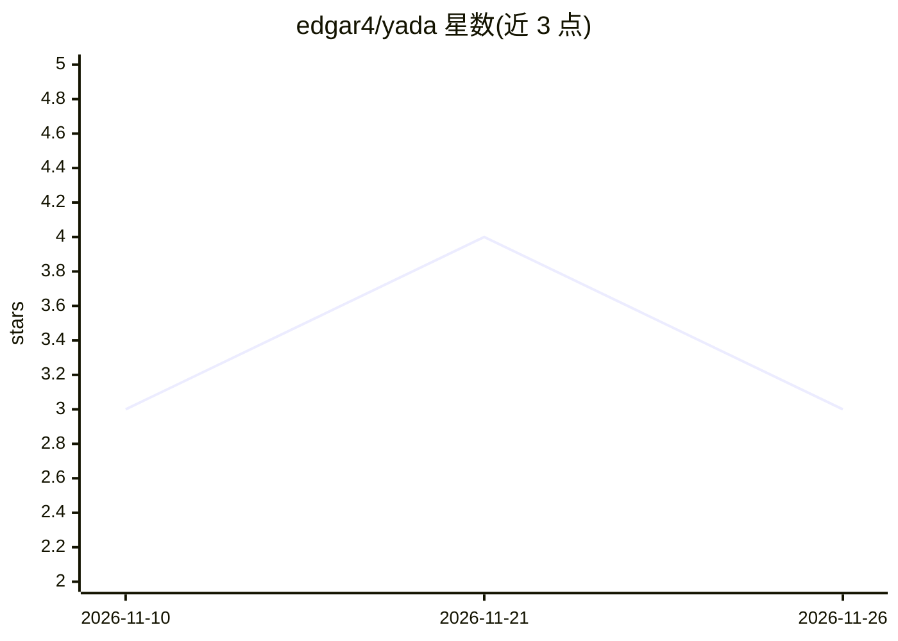

# edgar4/yada

⭐ 3 · TypeScript · MIT · 推送 2026-11-25 · [GitHub](https://github.com/edgar4/yada) · [官网](https://yada.edgar.co.ke) · 个人维护

**TypeScript 后端的 AI agent 运行时：托管工具循环与人审动作**

以 npm 包形式发布的 AI agent harness，供 TypeScript 后端嵌入以驱动助手界面。核心机制：带类型的工具与 MCP 服务器接入、循环执行工具调用并回填结果、写操作需显式批准并保存持久凭据、会话/运行/审批在 SQLite/PostgreSQL/MySQL 上持久化以支持重启恢复。模型层可插拔，官方 SDK 之外均可选安装，核心不带额外依赖。提供流式服务 API、浏览器客户端与聊天 widget。

## 筛选速览

| 维度 | 判定 | 备注 |
|---|---|---|
| AI 角色 | `ai-ecosystem` | LLM/agent 周边工具 |
| 许可风险 | `permissive` | MIT |
| 部署形态 | `self-host` | docker 或自建部署 |
| 模型依赖 | local-ok | 支持本地模型 |
| 硬件要求 | — | 无带数字的原话,不猜 |
| 安装摩擦 | `low` | 无编译、无系统依赖或容器化 |
| 成熟度 | — | 结构信号不足 |

## 能力要点

- 可插拔模型层：官方 SDK、Ollama、llama.cpp 及任意 OpenAI 兼容端点
- 工具执行循环：自动选择工具、运行步骤并回填结果推进目标
- 写操作需显式批准、最多执行一次并保留持久凭据
- 会话与审批持久化于 SQLite/PostgreSQL/MySQL，重启后可恢复

## 适用场景

- 在我的后端嵌入 assistant 接口并托管工具调用循环
- 让 agent 的写操作走人工审批并留下可审计凭据
- 复用 Claude/Codex/Cursor 的 SKILL.md 技能与 MCP 服务器
- 需要会话跨重启恢复的长时间运行 agent 任务

## 场景标签

`Agent 框架` · 领域:Agent 开发

## 证据(README 行号)

> L3: An AI agent harness for TypeScript backends. Bring any model, any MCP server and Agent Skills from Claude, Codex or 
> L5: - **Any model:** Anthropic and OpenAI on their official SDKs, Gemini, DeepSeek, Ollama, llama.cpp or any OpenAI-comp

## 星数曲线

2026-11-10 3 → 2026-11-26 3（+0）

---
*卡片 v1 · prompt 1.4 · 生成 2026-11-21 · 置信度 mid · 依据 README sha `3e691dc01e35` · [字段定义](../../DATASET.md)*
