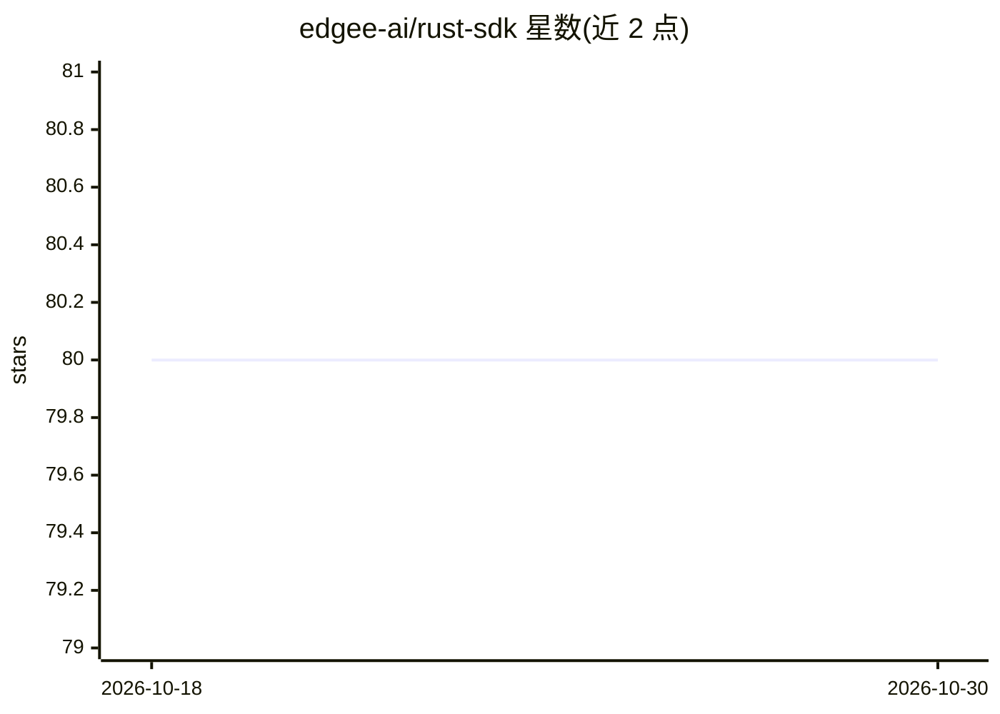

# edgee-ai/rust-sdk

⭐ 80 · Rust · Apache-2.0 · 推送 2026-10-21 · [GitHub](https://github.com/edgee-ai/rust-sdk) · [官网](https://www.edgee.cloud) · 组织维护

**Edgee AI Gateway 的官方 Rust SDK，提供类型安全的 LLM 请求接口**

Edgee 公司为其 AI Gateway 发布的官方 Rust 客户端库：通过 send() 发起非流式聊天补全请求，通过 stream() 获取流式响应，支持函数调用（tool calling）与 token 压缩指标读取；兼容 OpenAI 接口风格，底层模型经 Edgee 网关路由（如 anthropic/claude-haiku-4-5）。基于 tokio 实现 async/await，以 crates.io 包形式分发，使用需配置 EDGEE_API_KEY，Apache-2.0 许可。

## 筛选速览

| 维度 | 判定 | 备注 |
|---|---|---|
| AI 角色 | `ai-ecosystem` | LLM/agent 周边工具 |
| 许可风险 | `permissive` | Apache-2.0 |
| 部署形态 | `library` | 以包/库形式分发 |
| 模型依赖 | — | README 未给出锁定关系 |
| 硬件要求 | — | 无带数字的原话,不猜 |
| 安装摩擦 | `low` | 无编译、无系统依赖或容器化 |
| 成熟度 | — | 结构信号不足 |

## 能力要点

- send() 非流式与 stream() 流式聊天补全请求
- 支持函数调用（tool calling）
- 响应中提供 token 压缩指标
- 基于 tokio 的 async/await 类型安全接口

## 适用场景

- 在 Rust 应用中接入 Edgee AI Gateway 调用 LLM
- 构建需要流式输出或函数调用的 Rust AI 功能
- 读取压缩指标以监控 token 使用

## 场景标签

`模型网关` · 领域:Agent 开发

## 证据(README 行号)

> L3: Modern, type-safe Rust SDK for the Edgee AI Gateway.
> L33: let response = client.send("anthropic/claude-haiku-4-5", "Hello, world!").await?;

## 星数曲线

2026-10-18 80 → 2026-10-30 80（+0）

---
*卡片 v1 · prompt 1.4 · 生成 2026-10-24 · 置信度 high · 依据 README sha `bc71a3e0a707` · [字段定义](../../DATASET.md)*
