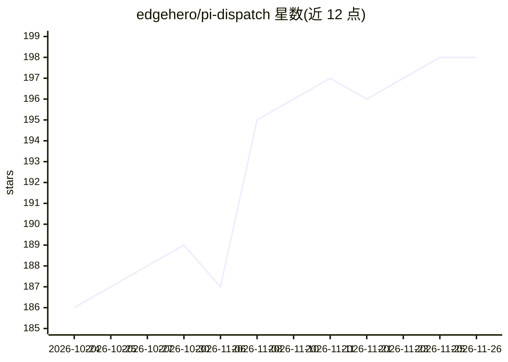

# edgehero/pi-dispatch

⭐ 198 · JavaScript · MIT · 推送 2026-11-25 · [GitHub](https://github.com/edgehero/pi-dispatch) · 组织维护

**让开发者从守着一个编码代理转向在后台并行运行多个**

pi-dispatch 是围绕 pi 编码代理的调度工具，自托管运行于自有电脑或服务器：任务按触发规则（定时、issue 标签、评论）自动启动，在一次性密封的 Docker/Podman 容器内执行，支出超过设定上限即停止，全部运行状态汇集到一个本地网页控制台。工作模式分为 in/near/out of the loop 三档，GitHub/GitLab 项目上默认停在提议变更处由人决定是否合并，另提供第二个代理做 AI 审查。安装依赖 Node.js 22.19+ 与 Docker，通过 npm 分发。

## 筛选速览

| 维度 | 判定 | 备注 |
|---|---|---|
| AI 角色 | `ai-ecosystem` | LLM/agent 周边工具 |
| 许可风险 | `permissive` | MIT |
| 部署形态 | `self-host` | docker 或自建部署 |
| 模型依赖 | — | README 未给出锁定关系 |
| 硬件要求 | — | 无带数字的原话,不猜 |
| 安装摩擦 | `low` | 无编译、无系统依赖或容器化 |
| 成熟度 | — | 结构信号不足 |

## 能力要点

- 每个任务在密封的一次性 Docker/Podman 容器中运行，结束后销毁
- 任务启动前检查支出上限，超限拒绝执行
- 网页控制台集中显示所有任务，本地运行于 http://pi-dispatch.localhost:4790
- in/near/out of the loop 三档参与度可按工作类型分别设置

## 适用场景

- 给 issue 打标签后让代理在后台自动修复
- 夜间定时批量整理代码
- 由第二个代理审查提议变更后我再决定是否合并

## 场景标签

`编码 Agent` `代码审查` `工作流自动化` · 领域:效率与自动化

## 证据(README 行号)

> L17: work: **dark engineering**. It runs the pi coding agent for you in the background, on
> L19: a sealed box that is thrown away afterwards, stops at the spending limit you set, and shows up live on one web page
> L35: Docker and Node.js 22.19 or newer, and a key from an AI

## 星数曲线

2026-10-24 186 → 2026-11-26 198（+12）

---
*卡片 v1 · prompt 1.4 · 生成 2026-11-25 · 置信度 mid · 依据 README sha `970e967f70fc` · [字段定义](../../DATASET.md)*
