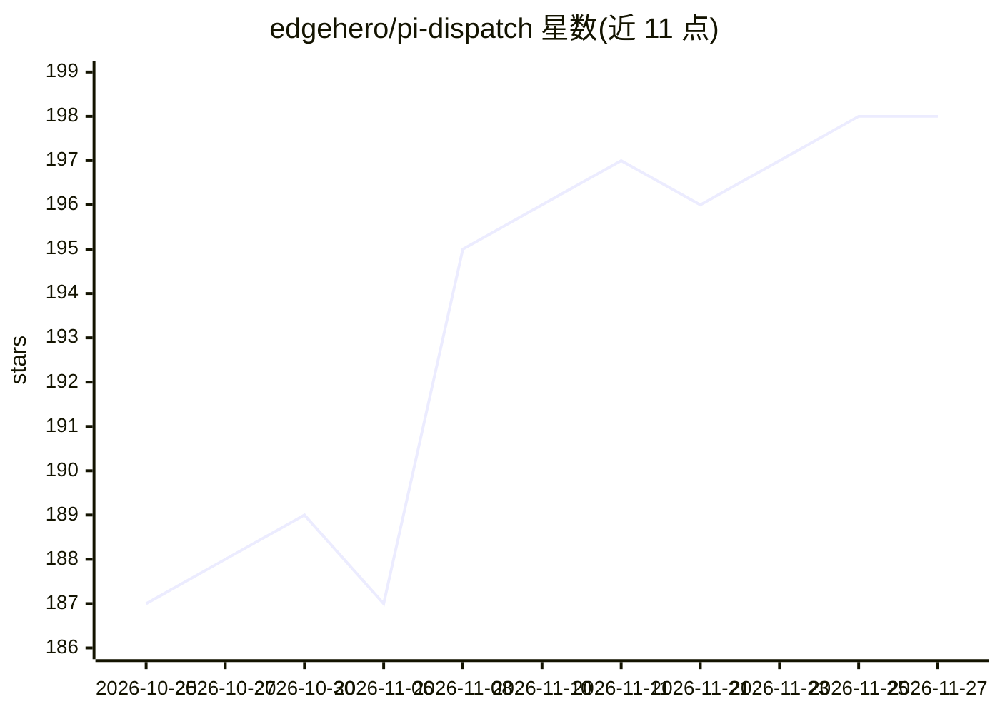

# edgehero/pi-dispatch

⭐ 198 · JavaScript · MIT · 推送 2026-11-26 · [GitHub](https://github.com/edgehero/pi-dispatch) · 组织维护

**自托管编排多 coding agent 后台运行的工具**

pi-dispatch 在自有电脑或服务器上后台运行 pi coding agent：每个任务在用后即弃的 Docker/Podman 容器中执行，任务启动前检查花费限额，所有任务在一个 Web 控制台（localhost:4790）上实时展示。按工作类型提供三档参与度：在环（旁观并介入）、近环（agent 提问时暂停等待）、离环（定时/issue 标签/评论触发，第二个 agent 复审）。GitHub/GitLab 项目默认停在提议变更处，由人决定是否合并。需 Docker 与 Node.js 22.19+，通过 npm 安装，AI 费用由用户自己的 provider key 或订阅承担。

## 筛选速览

| 维度 | 判定 | 备注 |
|---|---|---|
| AI 角色 | `ai-ecosystem` | LLM/agent 周边工具 |
| 许可风险 | `permissive` | MIT |
| 部署形态 | `self-host` | docker 或自建部署 |
| 模型依赖 | — | README 未给出锁定关系 |
| 硬件要求 | — | 无带数字的原话,不猜 |
| 安装摩擦 | `low` | 无编译、无系统依赖或容器化 |
| 成熟度 | — | 结构信号不足 |

## 能力要点

- 每个任务在密封的一次性 Docker/Podman 容器中运行
- 任务启动前检查花费限额，超限拒绝
- 三档参与度：in the loop / near the loop / out of the loop
- Zero touch 指标统计各项目需要人工介入的频率（7/30/90 天）

## 适用场景

- 让多个 agent 在后台并行处理修 issue、每夜整理等任务
- issue 被打标签或收到评论时自动触发 agent 修复
- 在服务器上长期运行 agent 任务并通过控制台集中查看

## 场景标签

`编码 Agent` `多智能体` · 领域:Agent 开发

## 证据(README 行号)

> L17: work: **dark engineering**. It runs the pi coding agent for you in the background, on
> L34: **1. Have these ready.** A computer or server that stays on (on a Mac or Windows machine, jobs run only while you a
> L35: Docker and Node.js 22.19 or newer, and a key from an AI

## 星数曲线

2026-10-25 187 → 2026-11-27 198（+11）

---
*卡片 v1 · prompt 1.4 · 生成 2026-11-27 · 置信度 high · 依据 README sha `37361872a4ed` · [字段定义](../../DATASET.md)*
