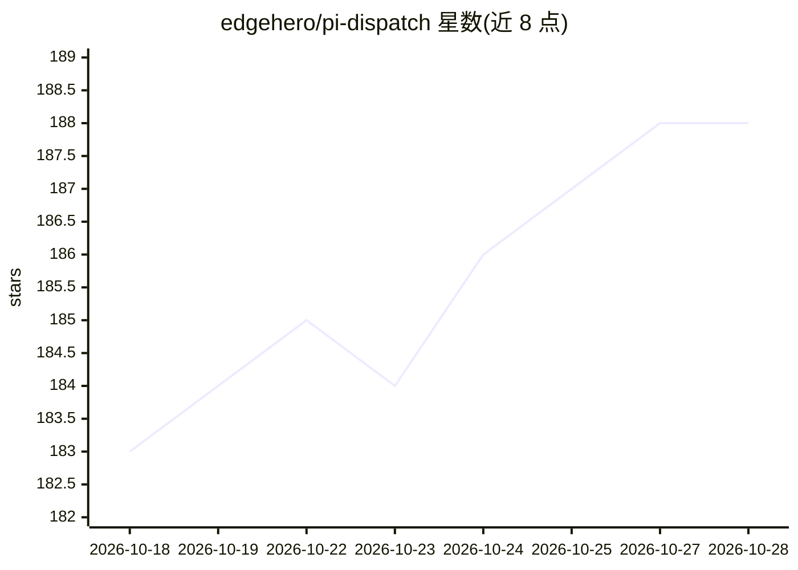

# edgehero/pi-dispatch

⭐ 188 · JavaScript · MIT · 推送 2026-10-28 · [GitHub](https://github.com/edgehero/pi-dispatch) · 组织维护

**把 pi 编码 agent 跑成自托管后台服务的队列与预算层**

面向已在使用开源编码 agent pi 的开发者：pi-dispatch 将其运行为自托管后台 worker，任务可由 CLI、cron 定时或 GitHub/GitLab/Forgejo/Azure DevOps 事件触发，每个任务在独立锁定的 Docker 或 Podman 容器（非 root、丢弃 Linux capabilities、用后即删）中执行。它在 pi 之上补上任务队列、并发控制、预算上限（按任务/项目/仓库/模型的 token 与美元上限，超限在容器启动前拒绝）、模型白名单与网页管理面板。限制：不支持 serverless 平台与远程容器后端，本地任务直接原地修改文件夹且无撤销。安装途径为 npm/npx（Node 22.19+），需 Docker 或 Podman。

## 筛选速览

| 维度 | 判定 | 备注 |
|---|---|---|
| AI 角色 | `ai-ecosystem` | LLM/agent 周边工具 |
| 许可风险 | `permissive` | MIT |
| 部署形态 | `self-host` | docker 或自建部署 |
| 模型依赖 | — | README 未给出锁定关系 |
| 硬件要求 | — | 无带数字的原话,不猜 |
| 安装摩擦 | `low` | 无编译、无系统依赖或容器化 |
| 成熟度 | — | 结构信号不足 |

## 能力要点

- 任务来源三合一：CLI、cron、forge 事件（GitHub/GitLab/Forgejo/Azure DevOps）共用同一队列与容器路径
- 花费上限在模型调用前检查：按任务/日/周/月/项目/模型的 token 与美元上限
- 每任务独立锁定容器：非 root、丢弃全部 Linux capabilities、指令只读挂载、用后删除
- 模型允许列表与项目级内存/CPU 尺寸分配，多机共享一个队列

## 适用场景

- 夜间定时任务：分诊 issue、更新报告、整理 backlog
- 在 forge 上打标签或 @pi 评论触发修复 PR，人工审核合并
- 多仓库多循环共享同一队列、预算和管理面板

## 场景标签

`编码 Agent` `工作流自动化` · 领域:效率与自动化

## 证据(README 行号)

> L9: pi is an open source coding agent that you normally run in a
> L16: pi has no job queue, no concurrency control, no spend limit and, by its own README, no permission
> L17: system. pi-dispatch adds exactly that layer and nothing else. It is not another agent to compare with

## 星数曲线

2026-10-18 183 → 2026-10-28 188（+5）

---
*卡片 v1 · prompt 1.4 · 生成 2026-10-22 · 置信度 mid · 依据 README sha `a18acea71127` · [字段定义](../../DATASET.md)*
