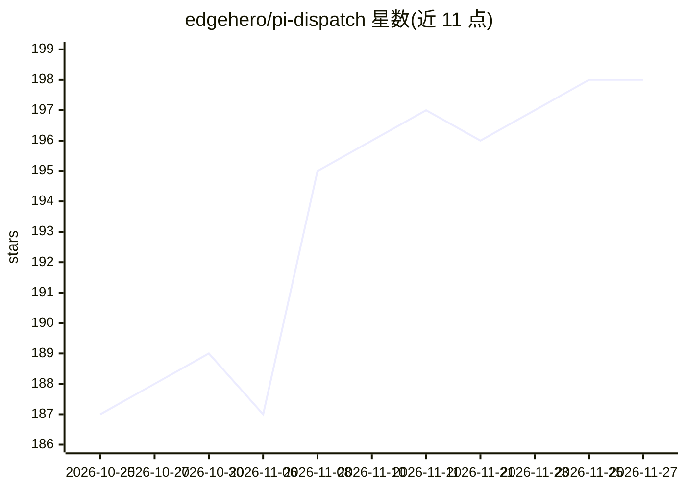

# edgehero/pi-dispatch

⭐ 198 · JavaScript · MIT · 推送 2026-11-26 · [GitHub](https://github.com/edgehero/pi-dispatch) · 组织维护

**让开发者把单个 AI 编码代理扩展为后台批量运行的调度器**

以后台方式运行 pi 编码代理的自托管调度系统：每个任务在一次性密封的 Docker/Podman 容器中执行，花费上限在任务开始前校验，控制台网页实时汇总所有任务状态。支持 in the loop/near the loop/out of the loop 三级参与度，触发方式含定时、issue 标签、评论与告警；GitHub/GitLab 上的变更默认停在 proposed change 等人决定，也可按任务类型显式允许落地。需自备 AI 提供商密钥或订阅，Windows 上安装路径与 Mac/Linux 不同。

## 筛选速览

| 维度 | 判定 | 备注 |
|---|---|---|
| AI 角色 | `ai-ecosystem` | LLM/agent 周边工具 |
| 许可风险 | `permissive` | MIT |
| 部署形态 | `self-host` | docker 或自建部署 |
| 模型依赖 | — | README 未给出锁定关系 |
| 硬件要求 | — | 无带数字的原话,不猜 |
| 安装摩擦 | `low` | 无编译、无系统依赖或容器化 |
| 成熟度 | — | 结构信号不足 |

## 能力要点

- 任务在一次性密封容器中运行，结束后丢弃
- 花费上限在任务执行前校验，超限拒绝
- 第二代理可评审第一代理的变更提案
- Zero touch 指标按项目统计需要人工介入的比率（7/30/90 天）

## 适用场景

- 夜间定时清理或修复带标签的 issue
- 让代理后台处理重复性代码整理工作
- 由第二个代理评审变更后再由人决定是否合入
- 在自托管服务器上集中查看多个代理任务

## 场景标签

`编码 Agent` `代码审查` · 领域:编码与开发

## 证据(README 行号)

> L17: work: **dark engineering**. It runs the pi coding agent for you in the background, on
> L18: your own computer or server. Agents start on their own and do the work, and a second agent can review it. Each job 
> L19: a sealed box that is thrown away afterwards, stops at the spending limit you set, and shows up live on one web page

## 星数曲线

2026-10-25 187 → 2026-11-27 198（+11）

---
*卡片 v1 · prompt 1.4 · 生成 2026-11-26 · 置信度 mid · 依据 README sha `f5d55a8bd4ab` · [字段定义](../../DATASET.md)*
