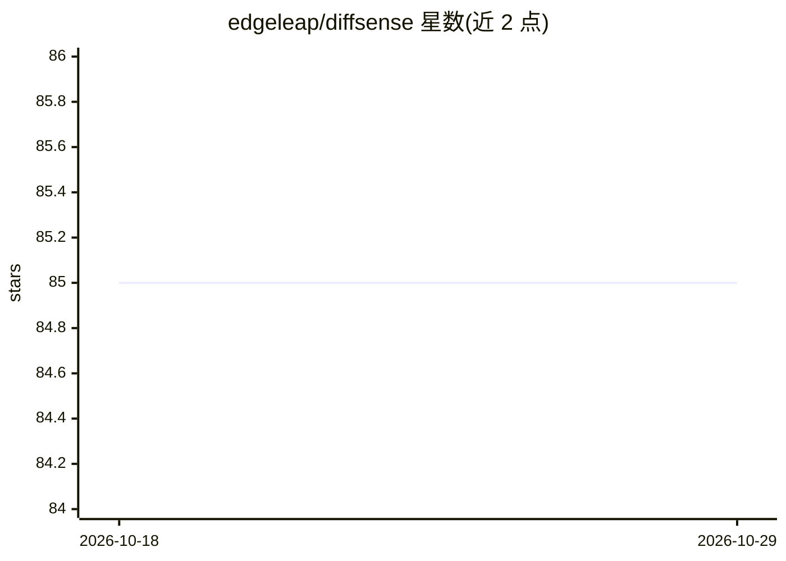

# edgeleap/diffsense

⭐ 85 · Shell · MIT · 推送 2025-12-25 · [GitHub](https://github.com/edgeleap/diffsense) · [官网](https://edgeleap.github.io/) · 个人维护

**macOS 上本地生成 git commit message 的命令行工具**

运行于 Apple Silicon Mac 的命令行工具：读取 staged 的 git 变更，调用 Apple Intelligence 的 AFM 3B 端侧模型生成 commit message，默认全程本地、代码不出机器；可选 Private Cloud Compute 或 ChatGPT 4o 后端。提供 balanced/verbose/minimal 三种消息风格、自定义规则文件（--byo）与 --nopopup 供 agent 调用。要求 macOS Tahoe 26+、git 2.50.1+ 与 Apple Silicon（M1-M5）。

## 筛选速览

| 维度 | 判定 | 备注 |
|---|---|---|
| AI 角色 | `ai-native` | 本体是模型或模型工具 |
| 许可风险 | `permissive` | MIT |
| 部署形态 | `None` |  |
| 模型依赖 | — | README 未给出锁定关系 |
| 硬件要求 | — | 无带数字的原话,不猜 |
| 安装摩擦 | `low` | 无编译、无系统依赖或容器化 |
| 成熟度 | — | 结构信号不足 |

## 能力要点

- AFM 3B 端侧模型本地生成，无需订阅或 API 配额
- 可选 Private Cloud Compute / ChatGPT 4o 后端
- 三种消息风格与自定义规则文件（--byo）
- --nopopup 模式适配 agent 工作流

## 适用场景

- 在终端对 staged 变更一键生成 commit message
- 按团队规范文件定制提交信息风格
- 在自动化脚本/agent 流程中静默生成提交信息

## 场景标签

`AI 写作` · 领域:内容生成

## 证据(README 行号)

> L4:  AI-powered git commit messages running locally on your Mac with Apple Intelligence.
> L12: - **Fast**: Generates messages in seconds using AFM 3B model

## 星数曲线

2026-10-18 85 → 2026-10-29 85（+0）

---
*卡片 v1 · prompt 1.4 · 生成 2026-10-24 · 置信度 high · 依据 README sha `e92ae7d48767` · [字段定义](../../DATASET.md)*
