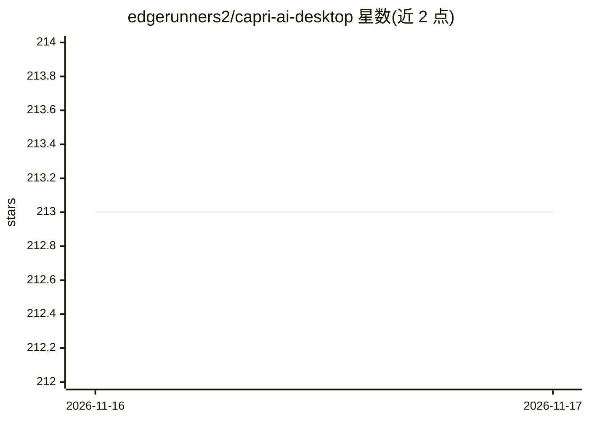

# edgerunners2/capri-ai-desktop

⭐ 213 · Python · NOASSERTION · 推送 2026-11-16 · [GitHub](https://github.com/edgerunners2/capri-ai-desktop) · 组织维护

**Windows 赛博朋克风格 AI 桌宠与语音助手应用**

面向 Windows 10/11 消费者的桌面宠物型 AI 助手：以常驻桌面的 HUD 角色形式提供语音/文字对话（80 种语言、唤醒词）、游戏画面实时解说叠加、桌面自动化（启动程序、控制光标、整理文件）、加入 Discord 等多应用语音通话并代为传话。AI 能力通过接入外部引擎实现：支持 Claude Code、Codex、Antigravity，可连 Ollama 本地模型与 DeepSeek API。对话日志与屏幕上下文本地存储；敏感操作需用户确认，提供 Esc 中断开关。以便携 zip 发布，macOS/Linux 尚未支持；通话模式为 beta 功能。

## 筛选速览

| 维度 | 判定 | 备注 |
|---|---|---|
| AI 角色 | `ai-native` | 本体是模型或模型工具 |
| 许可风险 | `none` | NOASSERTION |
| 部署形态 | `desktop` | 安装包/桌面程序 |
| 模型依赖 | local-ok | 支持本地模型 |
| 硬件要求 | — | 无带数字的原话,不猜 |
| 安装摩擦 | `low` | 无编译、无系统依赖或容器化 |
| 成熟度 | — | 结构信号不足 |

## 能力要点

- 接入 Claude Code / Codex / Antigravity 引擎，另可配 Ollama 本地模型与自定义适配器
- 语音通话模式：自主加入 Discord 等 12+ 应用通话，区分本机与对方音频并支持好友指令确认门控
- 桌面自动化：自有光标操作 UI，Esc 键即时中断
- 模块系统：.capri-mod/.capri-skin/.capri-code 三类模组，官方目录经恶意软件筛查

## 适用场景

- 让 AI 桌宠代为操作电脑：关程序、整理文件夹、合并 PDF、定时备份
- 游戏时叠加 AI 伴侣实时解说并启动 Steam 游戏
- 离开时让 AI 代接 Discord 语音并向队友传话
- 搭配 Ollama/DeepSeek-R1 做完全本地的离线 AI 伴侣

## 场景标签

`GUI 自动化` `AI 助手` `语音 Agent` · 领域:效率与自动化

## 证据(README 行号)

> L3: **Capri AI Desktop** turns your Windows 10/11 screen into an interactive cyberpunk workspace. Instead of staring at 
> L113: 2. **Capri routes it** to the AI engine you selected.
> L154: No. Download the app, connect your AI and describe what you need in plain language.

## 星数曲线

2026-11-16 213 → 2026-11-17 213（+0）

---
*卡片 v1 · prompt 1.4 · 生成 2026-11-17 · 置信度 high · 依据 README sha `6471c7595bc4` · [字段定义](../../DATASET.md)*
