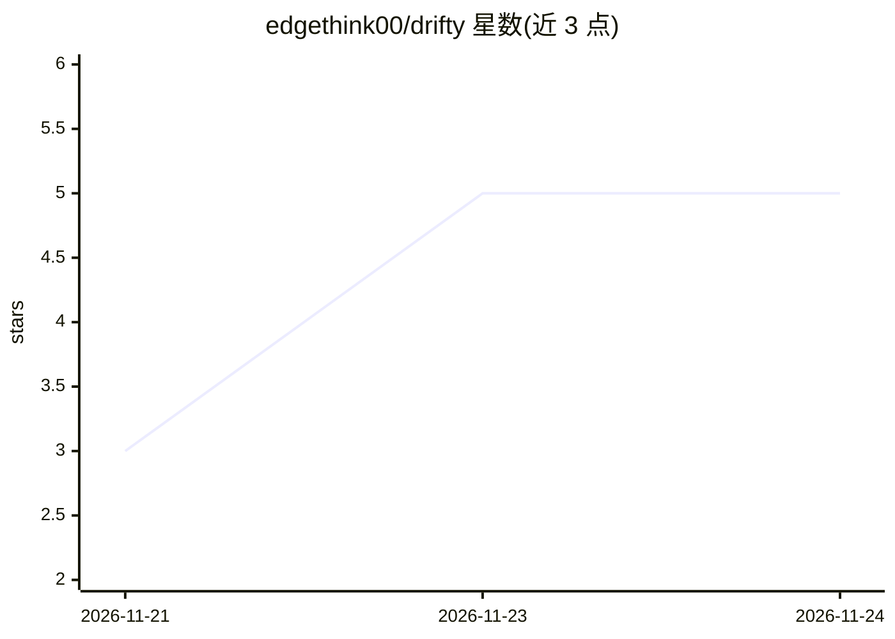

# edgethink00/drifty

⭐ 5 · TypeScript · AGPL-3.0 · 推送 2026-11-23 · [GitHub](https://github.com/edgethink00/drifty) · [官网](https://drifty.so) · 个人维护

**macOS/Windows 的 AI 自动时间追踪应用，免手动计时**

Drifty 自动记录前台应用、窗口和受支持的浏览器标签页，由 AI 将每段时间分类为专注、分心或中性，用户无需手动启动计时或打标签。分类依据屏幕内容而非仅应用名；项目可按一句描述自动归类。AI 连接支持本地模型、自托管端点、自有 API key、Codex CLI、Claude Code 或 Drifty Cloud。数据默认保存在本地，官方版需登录 Drifty 账户，源码构建可完全离线运行。Cloud 服务器与 iPhone 应用不在本仓库内。

## 筛选速览

| 维度 | 判定 | 备注 |
|---|---|---|
| AI 角色 | `ai-enhanced` | 去掉 AI 部分产品仍成立 |
| 许可风险 | `viral` | AGPL-3.0 |
| 部署形态 | `library` | 以包/库形式分发 |
| 模型依赖 | — | README 未给出锁定关系 |
| 硬件要求 | — | 无带数字的原话,不猜 |
| 安装摩擦 | `low` | 无编译、无系统依赖或容器化 |
| 成熟度 | — | 结构信号不足 |

## 能力要点

- 自动记录应用、窗口与浏览器标签并按屏幕内容分类专注/分心
- 支持本地模型、自托管端点、OpenAI/Anthropic/OpenRouter key 等多种 AI 连接
- 聊天问答与供 Claude Code 等读取记录的只读 skill/connector
- 本地优先：源码构建无需账户即可完整运行

## 适用场景

- 不想手动计时、想自动生成分心/专注时间线
- 用一个描述让 AI 自动把相关工作归入项目
- 通过聊天查询自己一天的时间记录
- 在本地保存活动历史、按需选择 AI 端点

## 场景标签

 · 领域:生产力/时间追踪

## 证据(README 行号)

> L8: in front of you, and AI sorts each stretch into focus, drift or neutral. You
> L19: - **Bring your own AI.** A local model Drifty downloads for you, a self-hosted
> L33: Your activity history stays on your computer unless you use a feature that

## 星数曲线

2026-11-21 3 → 2026-11-24 5（+2）

---
*卡片 v1 · prompt 1.4 · 生成 2026-11-22 · 置信度 mid · 依据 README sha `62f1d9b7e246` · [字段定义](../../DATASET.md)*
