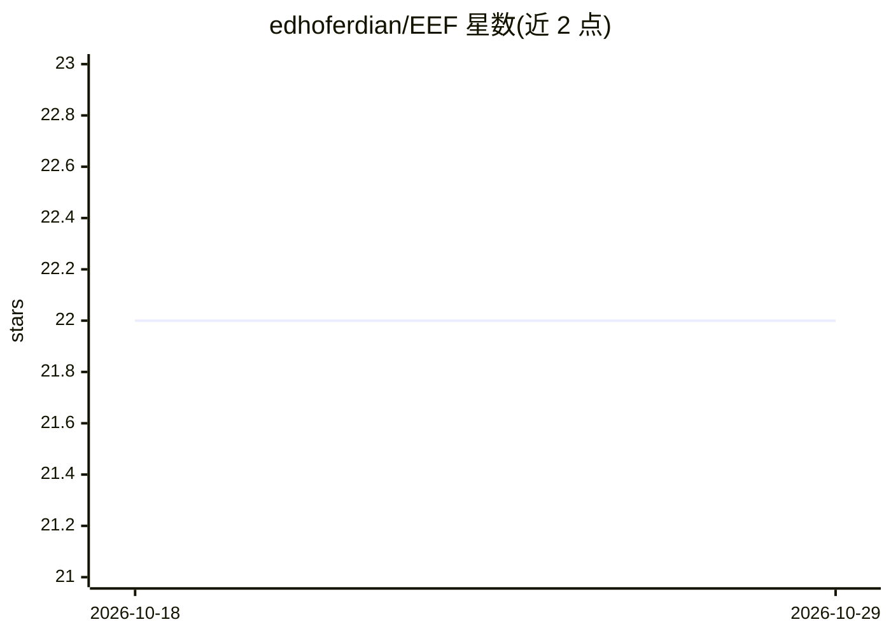

# edhoferdian/EEF

⭐ 22 · Python · MIT · 推送 2026-10-27 · [GitHub](https://github.com/edhoferdian/EEF) · 个人维护

**面向 Claude Code 等 10+ 编码 agent 的 38 个原生技能集与适配器生态**

一套自包含的 SKILL.md 技能包（38 个），覆盖后端/前端/API 设计、部署与容器、代码评审、规范挖掘、法务与营销等开发全流程场景。技能为纯 Markdown，无 Claude 专有语法；通过 npx eef-install、手动 .skill 上传、install.sh 安装脚本或 Claude Code 插件市场四种方式安装。为 Cursor、Windsurf、Devin、GitHub Copilot、Cline、Kiro 等十余种编码 agent 提供由 CI 生成校验的适配器，另有实验性的多 agent 编排层（agent 定义、workflow、tier 化模型路由）。

## 筛选速览

| 维度 | 判定 | 备注 |
|---|---|---|
| AI 角色 | `ai-knowledge` | 知识聚合/清单类 |
| 许可风险 | `permissive` | MIT |
| 部署形态 | `library` | 以包/库形式分发 |
| 模型依赖 | — | README 未给出锁定关系 |
| 硬件要求 | — | 无带数字的原话,不猜 |
| 安装摩擦 | `low` | 无编译、无系统依赖或容器化 |
| 成熟度 | `idea` | |

## 能力要点

- 38 个纯 Markdown 技能，覆盖工程设计、运维与跨领域实践
- 为 10+ 编码 agent 生成适配器（Cursor/Windsurf/Copilot/Cline/Kiro 等），CI 保证与源同步
- 四种安装途径：npx、.skill 上传、安装脚本、Claude Code 插件市场
- 实验性 agent 编排层：tier（light/standard/deep）化模型路由与多 agent workflow

## 适用场景

- 给 Claude Code 或 Cursor 等编码 agent 补充代码评审、API 设计、部署等技能
- 在多个编码 agent 工具间复用同一套技能而不手工复制
- 通过 eef-install doctor/update 管理已安装技能与 hooks 的版本

## 场景标签

`代码审查` `提示工程` · 领域:Agent 开发

## 证据(README 行号)

> L3: A native Claude Code skill ecosystem — 38 skills covering engineering
> L106: ## Other harnesses (not just Claude Code)
> L108: These skills are plain Markdown with no Claude-specific syntax, so they

## 星数曲线

2026-10-18 22 → 2026-10-29 22（+0）

---
*卡片 v1 · prompt 1.4 · 生成 2026-10-27 · 置信度 high · 依据 README sha `f6760c3cc128` · [字段定义](../../DATASET.md)*
