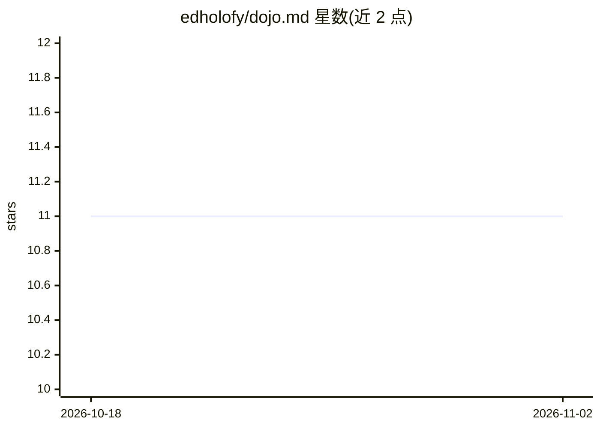

# edholofy/dojo.md

⭐ 11 · TypeScript · MIT · 推送 2026-05-02 · [GitHub](https://github.com/edholofy/dojo.md) · [官网](https://dojo.md) · 组织维护

**AI agent 训练场：场景化课程训练并生成 SKILL.md 技能文档**

面向 AI agent 的训练与评测工具：通过 125 门预置课程（6,250+ 场景）对模型进行迭代训练，LLM judge 打分，失败模式被提炼为按模型区分的 SKILL.md 文档，供 Claude Code、OpenClaw、Cursor 等 MCP 兼容 agent 复用，无需微调。提供 npm CLI（经 OpenRouter 接入 200+ 模型）与 MCP server 两种使用方式，后者在 Claude Code/Codex 订阅内训练无需额外 API key。另含 arena 模式做模型对比基准。

## 筛选速览

| 维度 | 判定 | 备注 |
|---|---|---|
| AI 角色 | `ai-ecosystem` | LLM/agent 周边工具 |
| 许可风险 | `permissive` | MIT |
| 部署形态 | `library` | 以包/库形式分发 |
| 模型依赖 | locked-api |  |
| 硬件要求 | — | 无带数字的原话,不猜 |
| 安装摩擦 | `low` | 无编译、无系统依赖或容器化 |
| 成熟度 | — | 结构信号不足 |

## 能力要点

- 125 门预置课程、6,250+ 场景，覆盖客服/营销/工程等领域
- 训练循环：场景→LLM judge→失败模式→按模型生成 SKILL.md
- 可作为 MCP server 在 Claude Code/Codex 内零额外费用自训练
- arena 模式支持多模型同题对比基准

## 适用场景

- 让 agent 在冷邮件、广告文案等任务上通过训练达到目标分
- 为不同模型各自生成可移植的 SKILL.md 技能文档
- 在同一课程上对比多个模型的原始能力

## 场景标签

`模型评测` `提示工程` · 领域:Agent 开发

## 证据(README 行号)

> L38: Scenarios → Mock Services → LLM Judge → Failure Patterns → SKILL.md → Re-inject → Repeat
> L143: dojo.md generates AgentSkills-standard SKILL.md files. Train once, use everywhere.
> L156: MCP tools: `dojo_discover`, `dojo_train`, `dojo_tool`, `dojo_submit`, `dojo_results`, `dojo_skill`, `dojo_apply`

## 星数曲线

2026-10-18 11 → 2026-11-02 11（+0）

---
*卡片 v1 · prompt 1.4 · 生成 2026-11-02 · 置信度 high · 依据 README sha `0dbacc62f2dd` · [字段定义](../../DATASET.md)*
