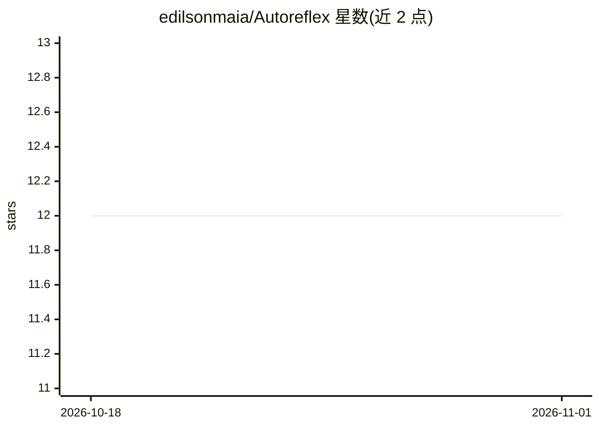

# edilsonmaia/Autoreflex

⭐ 12 · Python · 推送 2026-04-26 · [GitHub](https://github.com/edilsonmaia/Autoreflex) · [官网](https://costafavero.com.br) · 个人维护

**面向 AI agent 的本地技能知识库服务器：语义检索复用会话知识**

本地运行的 FastAPI 服务器，将 Markdown 格式的知识单元（skills）创建、索引并通过向量语义检索供 AI agent 查询，充当 agent 的外部持久记忆：新会话只检索相关 skill 而非重放全部历史，README 称可降低 85% 的会话启动 token 消耗。使用本地 Qdrant 向量库与可配置的 embedding 模型（默认 google/embeddinggemma-300m，768 维），全程本地运行无需 Docker，通过 install.py 安装器完成 venv、依赖与模型下载，首次下载模型需 Hugging Face token。

## 筛选速览

| 维度 | 判定 | 备注 |
|---|---|---|
| AI 角色 | `ai-ecosystem` | LLM/agent 周边工具 |
| 许可风险 | `none` | — |
| 部署形态 | `None` |  |
| 模型依赖 | — | README 未给出锁定关系 |
| 硬件要求 | — | 无带数字的原话,不猜 |
| 安装摩擦 | `medium` | 含编译或系统依赖之一 |
| 成熟度 | — | 结构信号不足 |

## 能力要点

- FastAPI 本地服务（127.0.0.1:8090）+ 本地 Qdrant 向量检索
- 默认 embedding 模型 google/embeddinggemma-300m，可配置并支持 CUDA 自动检测
- Markdown skills + JSON metadata 存储，跨会话复用
- 安装器提供安装/运行/修复三模式，无需 Docker

## 适用场景

- 长会话 agent 用 skill 检索替代重放历史以降低 token 消耗
- webhook/cron 等事件驱动的 agent 加载既有知识执行任务
- 把解决过的问题沉淀为可检索 skill 形成团队知识库

## 场景标签

`Agent 记忆` `语义搜索` · 领域:Agent 开发

## 证据(README 行号)

> L16: **Autoreflex** é um servidor local que cria, indexa e consulta *skills* — pequenas unidades de conhecimento em Mark
> L18: O sistema sobe localmente com FastAPI, usa o Qdrant como base vetorial e o modelo `google/embeddinggemma-300m` (con

## 星数曲线

2026-10-18 12 → 2026-11-01 12（+0）

---
*卡片 v1 · prompt 1.4 · 生成 2026-11-01 · 置信度 high · 依据 README sha `aa0f82a744bc` · [字段定义](../../DATASET.md)*
