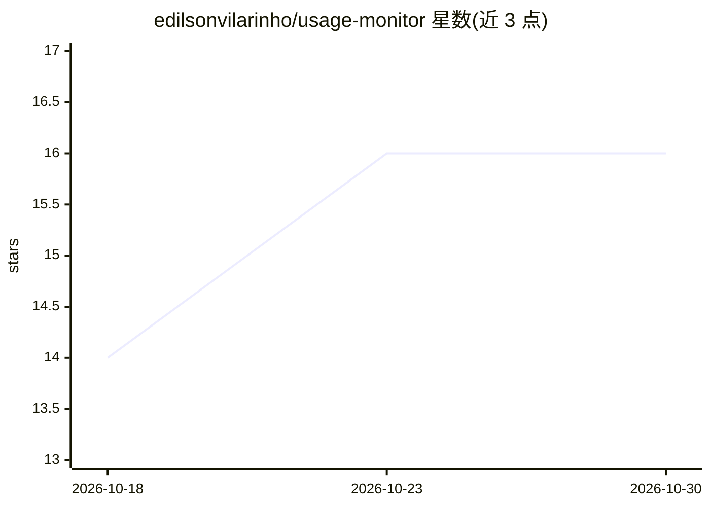

# edilsonvilarinho/usage-monitor

⭐ 16 · Kotlin · MIT · 推送 2026-10-29 · [GitHub](https://github.com/edilsonvilarinho/usage-monitor) · 个人维护

**桌面 HUD 汇总各 AI 编程工具的配额、用量与成本**

用 Kotlin/Compose 构建的桌面应用（含终端模式），在一个面板读取 Claude Code、Codex、MiniMax、DeepSeek、OpenCode、Kilo、OpenRouter、Gemini CLI、Cursor 等 AI 编程工具的配额、用量与成本：屏幕边缘 notch 每账户一环、每配额一弧；本地 SQLite 保存历史，读取已有凭据，不外发 prompt 内容。支持会话成本拆分、耗尽预测、告警、CSV/JSON/PDF 导出、Telegram 通知，以及可选的自托管团队聚合服务器。终端模式含 status/tui/statusline 与 Linux 无头 systemd 服务。macOS DMG 未签名，不支持 Alpine/ARM64。

## 筛选速览

| 维度 | 判定 | 备注 |
|---|---|---|
| AI 角色 | `ai-ecosystem` | LLM/agent 周边工具 |
| 许可风险 | `permissive` | MIT |
| 部署形态 | `desktop` | 安装包/桌面程序 |
| 模型依赖 | locked-api |  |
| 硬件要求 | — | 无带数字的原话,不猜 |
| 安装摩擦 | `low` | 无编译、无系统依赖或容器化 |
| 成熟度 | — | 结构信号不足 |

## 能力要点

- 单一面板读取 10 类 AI 编程工具的配额/用量/成本
- 本地 SQLite 历史与耗尽预测、75/90/100% 告警
- Claude Code / tmux statusline 与脚本可用的 check/wait 命令
- 可选自托管团队服务器聚合多机器用量

## 适用场景

- 同时订阅多个 AI 编程工具时统一查看配额和花费
- 在终端或 tmux 状态栏实时查看 Claude Code 配额与会话成本
- 团队自托管服务器汇总成员用量趋势

## 场景标签

`LLM 可观测性` · 领域:评测与运维

## 证据(README 行号)

> L12: A desktop HUD for the quotas, usage and cost of every AI coding tool you pay for: **Claude Code**,
> L184: |Integration|Reads|Needs|
> L186: |Anthropic (Claude Code)|`/api/oauth/usage`|`~/.claude/.credentials.json`|

## 星数曲线

2026-10-18 14 → 2026-10-30 16（+2）

---
*卡片 v1 · prompt 1.4 · 生成 2026-10-30 · 置信度 high · 依据 README sha `d5460eddef32` · [字段定义](../../DATASET.md)*
