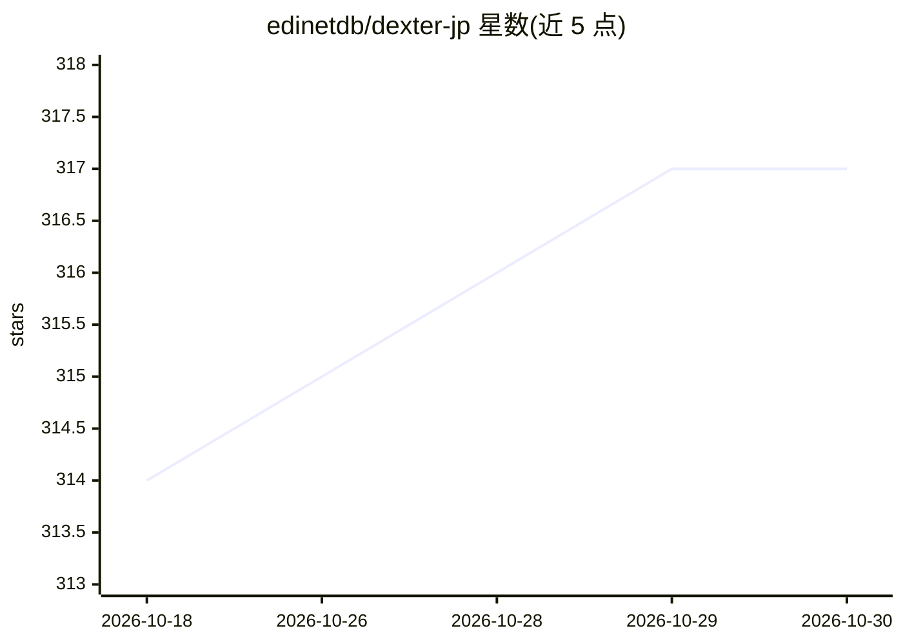

# edinetdb/dexter-jp

⭐ 317 · TypeScript · MIT · 推送 2026-10-08 · [GitHub](https://github.com/edinetdb/dexter-jp) · [官网](https://edinetdb.jp) · 组织维护

**日本上市公司的自律型金融研究 AI 代理，自动规划并生成报告**

基于 EDINET DB 与 J-Quants 数据的日本股研究 CLI 代理，由 virattt/dexter（美股版）fork 改造。用自然语言提问后，代理自行制定分析计划、并行调用多个数据工具（财务数据、有价证券报告书、搜索、X 等）并生成结构化报告；`/check` 命令可将用户假设拆成主张逐条对照有报段落，标注「佐证/矛盾/无关」及出典。支持多 LLM（OpenAI/Anthropic/Google/xAI/OpenRouter/Ollama 等）切换，可经 Slack/Discord/LINE/WhatsApp 网关使用。声明仅用于教育目的，不输出投资建议或目标股价；`/check` 需另配 TypeSafe API key。

## 筛选速览

| 维度 | 判定 | 备注 |
|---|---|---|
| AI 角色 | `ai-native` | 本体是模型或模型工具 |
| 许可风险 | `permissive` | MIT |
| 部署形态 | `self-host` | docker 或自建部署 |
| 模型依赖 | local-ok | 支持本地模型 |
| 硬件要求 | — | 无带数字的原话,不猜 |
| 安装摩擦 | `low` | 无编译、无系统依赖或容器化 |
| 成熟度 | — | 结构信号不足 |

## 能力要点

- 自然语言提问后自动规划、并行调用多数据源并生成报告的代理循环（LangChain）
- /check 将假设拆成主张逐条对照有报段落，输出带出典的佐证/矛盾判定
- 支持 OpenAI/Anthropic/Google/xAI/OpenRouter/Ollama/Claude Agent SDK 等多 LLM 切换
- Slack/Discord/LINE/WhatsApp 消息网关与跨会话记忆、研究规则自定义

## 适用场景

- 让我比较索尼与任天堂的 ROE 和自有资本比率并汇总成报告
- 把我的投资假设逐条对照公司有价证券报告书原文核验
- 通过 Slack 或 Discord 直接向代理提问做日本股研究

## 场景标签

`金融量化` `科研工具` · 领域:学习与行业

## 证据(README 行号)

> L7: EDINET DB + J-Quants で動く、日本株特化の金融AIエージェント。
> L178: **「ソニーと任天堂のROEと自己資本比率を有報の値で並べて、事業等のリスクの記載も比較して」** と聞くと:
> L251: エージェントループ（LangChain）

## 星数曲线

2026-10-18 314 → 2026-10-30 317（+3）

---
*卡片 v1 · prompt 1.4 · 生成 2026-10-21 · 置信度 mid · 依据 README sha `142cd3461544` · [字段定义](../../DATASET.md)*
