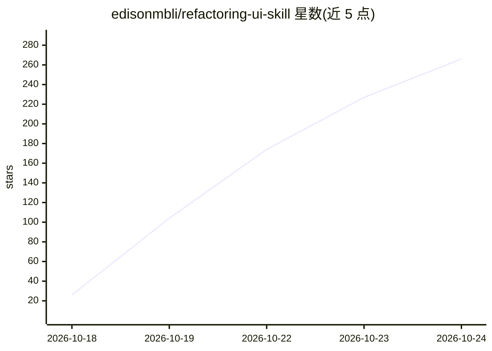

# edisonmbli/refactoring-ui-skill

⭐ 266 · Python · NOASSERTION · 推送 2026-08-21 · [GitHub](https://github.com/edisonmbli/refactoring-ui-skill) · [官网](https://www.refactoringui.com) · 个人维护 · 中文 README

**给 AI 编码助手用的 Web UI 设计规则与走查 Skill**

从《Refactoring UI》一书独立重实现的 Claude Skill：把全书拆成 151 条可追溯规则（症状→机制→做法→数值），以约束层和诊断层形式供 AI 编码助手使用——生成前提供设计约束与 Design Token，生成后按七个固定视角（层级/间距/排版/色彩/深度/图像/收尾）对页面做走查，输出带规则号和严重度的问题清单。另支持从零搭设计系统（token JSON、Tailwind 主题、CSS 变量）。以插件或普通 Skill 安装，兼容 Codex/Copilot/Cursor 等工具；脚本需 Python 3.9+，无第三方依赖，非官方项目。

## 筛选速览

| 维度 | 判定 | 备注 |
|---|---|---|
| AI 角色 | `ai-ecosystem` | LLM/agent 周边工具 |
| 许可风险 | `none` | NOASSERTION |
| 部署形态 | `None` |  |
| 模型依赖 | — | README 未给出锁定关系 |
| 硬件要求 | — | 无带数字的原话,不猜 |
| 安装摩擦 | `low` | 无编译、无系统依赖或容器化 |
| 成熟度 | — | 结构信号不足 |

## 能力要点

- 151 条可追溯规则，六段式结构（规则·为什么·怎么做·数值·Tailwind 写法·失败长什么样）
- 七视角固定顺序走查，finding 按严重度排序并挂规则号
- 生成 Design Token JSON、Tailwind 主题、框架无关 CSS 与 DESIGN.md
- 占位符约定（如 bg-{primary}-600）防止注入具体色值，不覆盖已有设计系统

## 适用场景

- 让 AI 编码助手在生成界面前遵守设计约束，生成后走查问题
- 给没有设计规范的项目生成一套 Design Token 与设计系统
- 跨工具（Claude Code/Codex/Copilot/Cursor 等）复用同一套设计规则

## 场景标签

`提示工程` · 领域:Agent 开发

## 证据(README 行号)

> L29: 这个 Skill 干的是反过来的活。它是约束层和诊断层，是规则书和评审员，不是造型师。
> L77: 插件机制是 Claude Code 专属的，但 Skill 本身不是。它就是一堆 Markdown，而且刻意做成了“一个索引 + 按需加载的引用文件”，任何能读文件的助手都能照着走，告诉它一次就行。
> L139: 三层结构，渐进式加载。`SKILL.md`（约 220 行）放路由、12 条通用铁律和 4 个工作流，常驻上下文；14 个引用文件按需加载，一次只装一个；脚本和模板垫在最底下。

## 星数曲线

2026-10-18 26 → 2026-10-24 266（+240）

---
*卡片 v1 · prompt 1.4 · 生成 2026-10-22 · 置信度 mid · 依据 README sha `20459499002a` · [字段定义](../../DATASET.md)*
