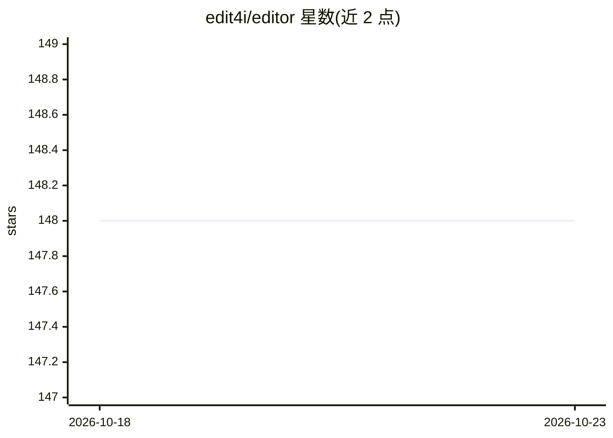

# edit4i/editor

⭐ 148 · Svelte · 推送 2026-01-24 · [GitHub](https://github.com/edit4i/editor) · [官网](https://edit4i.com) · 个人维护

**Go/Wails 编写的 AI 代码编辑器，自带 LLM 与本地 RAG**

开源桌面代码编辑器，作者定位为 Cursor 与 Windsurf 的替代选项：前端用 SvelteJS 与 Monaco，后端 Go + Wails 实现跨平台原生桌面。功能包括 Tree-sitter 文档符号、Git 工作流、内置终端、Vim 模式与 Pinned Prompts；规划支持自带 LLM API key、本地 RAG 与自主 Agent。README 明确声明项目处于极早期、不适合生产使用，需从源码构建，Docker 构建暂不可用。许可未定，部分协作功能或采用商业许可。

## 筛选速览

| 维度 | 判定 | 备注 |
|---|---|---|
| AI 角色 | `ai-enhanced` | 去掉 AI 部分产品仍成立 |
| 许可风险 | `none` | — |
| 部署形态 | `self-host` | docker 或自建部署 |
| 模型依赖 | — | README 未给出锁定关系 |
| 硬件要求 | — | 无带数字的原话,不猜 |
| 安装摩擦 | `low` | 无编译、无系统依赖或容器化 |
| 成熟度 | `idea` | |

## 能力要点

- Monaco + SvelteJS 前端，Go + Wails 后端的桌面编辑器
- Tree-sitter 符号解析、Git 集成、内置终端与 Vim 模式
- 规划自带 LLM（Copilot/OpenAI/Anthropic）与自主 Agent 能力

## 适用场景

- 需要一个可自托管、可用自有 API key 的 AI 编辑器
- 自行构建并跟进早期 AI 编辑器项目的开发
- 体验 Monaco + Vim 模式 + Git 一体的编辑器

## 场景标签

`编码 Agent` · 领域:编码与开发

## 证据(README 行号)

> L3: An AI-powered agentic editor that enhances your coding experience with intelligent context understanding and seamles
> L32: - **Automatic Context Generation** 🧠: Intelligently understands your codebase and provides relevant context for sma

## 星数曲线

2026-10-18 148 → 2026-10-23 148（+0）

---
*卡片 v1 · prompt 1.4 · 生成 2026-10-22 · 置信度 mid · 依据 README sha `fba951a8a747` · [字段定义](../../DATASET.md)*
