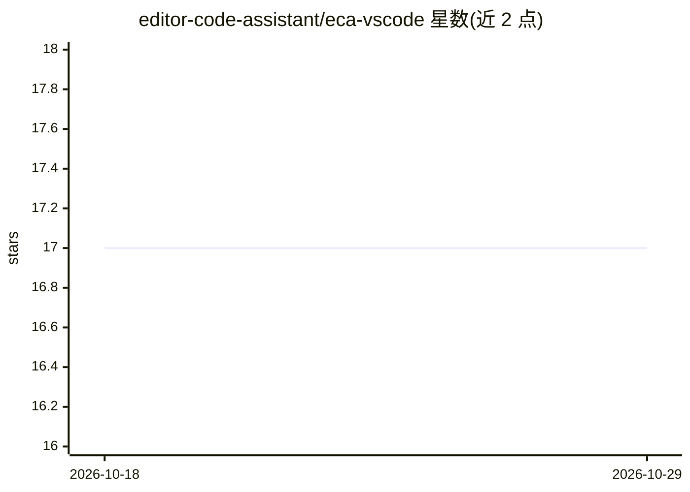

# editor-code-assistant/eca-vscode

⭐ 17 · TypeScript · Apache-2.0 · 推送 2026-10-26 · [GitHub](https://github.com/editor-code-assistant/eca-vscode) · [官网](https://marketplace.visualstudio.com/items?itemName=editor-code-assistant.eca) · 组织维护

**VS Code 的 AI 结对编程客户端，连接外部 eca 服务器**

VS Code 扩展，作为 Editor Code Assistant (ECA) 的前端客户端：连接外部 eca 服务器进程，提供交互式聊天、代码建议、上下文管理与行内对话等命令。扩展可自动下载 eca 服务器二进制并管理其进程，也可通过 eca.serverPath 指定自定义路径。支持将服务器置于 docker/podman/bubblewrap 等沙箱中运行，容器场景需关闭 sendProcessId 以避免父进程看门狗误关服务器。开发需克隆 eca-webview 子模块，用 npm run dev:gui 启动 Vite 开发服务器并按 F5 调试。

## 筛选速览

| 维度 | 判定 | 备注 |
|---|---|---|
| AI 角色 | `ai-ecosystem` | LLM/agent 周边工具 |
| 许可风险 | `permissive` | Apache-2.0 |
| 部署形态 | `None` |  |
| 模型依赖 | — | README 未给出锁定关系 |
| 硬件要求 | — | 无带数字的原话,不猜 |
| 安装摩擦 | `low` | 无编译、无系统依赖或容器化 |
| 成熟度 | — | 结构信号不足 |

## 能力要点

- 连接外部 eca 服务器提供聊天、代码建议与上下文管理
- 自动下载 eca 服务器并管理进程生命周期
- 行内对话命令将流式回答写入光标处注释线程
- 支持以 wrapper 脚本将服务器置于 docker/podman/bubblewrap 沙箱

## 适用场景

- 在 VS Code 内通过聊天与行内对话获得 AI 编程辅助
- 复用已有聊天历史在任意文件中继续提问
- 在沙箱环境中安全运行 eca 服务器

## 场景标签

`编码 Agent` `代码生成` · 领域:编码与开发

## 证据(README 行号)

> L7: ECA (Editor Code Assistant) Vscode is an AI-powered pair-programming client for VsCode.
> L8: It connects to an external `eca` server process to provide interactive chat, code suggestions, context management an

## 星数曲线

2026-10-18 17 → 2026-10-29 17（+0）

---
*卡片 v1 · prompt 1.4 · 生成 2026-10-29 · 置信度 high · 依据 README sha `2370e26cef64` · [字段定义](../../DATASET.md)*
