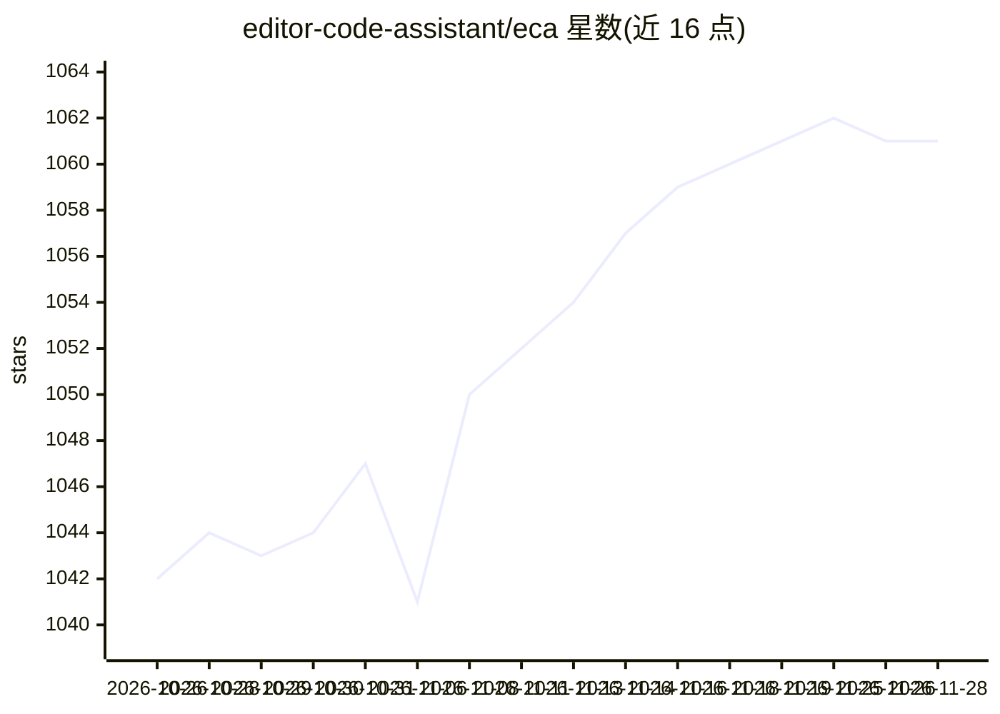

# editor-code-assistant/eca

⭐ 1,061 · Clojure · Apache-2.0 · 推送 2026-11-27 · [GitHub](https://github.com/editor-code-assistant/eca) · [官网](http://eca.dev) · 组织维护

**为任意编辑器接入 LLM 的 AI 结对编程服务端**

ECA 是一个编辑器无关的 AI 结对编程工具，用类似 LSP 的 JSONRPC 协议在编辑器与 LLM 之间架起中间服务端：编辑器插件启动 `eca server`，通过 stdin/stdout 通信。功能包括 chat、rewrite、completion，支持配置多个 agent（不同模型/工具/行为）、MCP 资源与提示作为上下文、OpenTelemetry 用量导出。提供 Emacs/VsCode/Intellij/Desktop/CLI 等多端插件，服务端由 Clojure 编写，插件启动时自动下载。

## 筛选速览

| 维度 | 判定 | 备注 |
|---|---|---|
| AI 角色 | `ai-ecosystem` | LLM/agent 周边工具 |
| 许可风险 | `permissive` | Apache-2.0 |
| 部署形态 | `None` |  |
| 模型依赖 | local-ok | 支持本地模型 |
| 硬件要求 | — | 无带数字的原话,不猜 |
| 安装摩擦 | `low` | 无编译、无系统依赖或容器化 |
| 成熟度 | — | 结构信号不足 |

## 能力要点

- 编辑器无关协议（LSP 风格），一套配置适配多编辑器
- chat、rewrite、completion 三类 LLM 功能
- 多 agent 配置：不同模型、工具与行为；支持 MCP 资源与提示上下文
- 多模型登录：OpenAI、Anthropic、Copilot、本地 Ollama 等

## 适用场景

- 在 Emacs/VsCode/Intellij 等编辑器中获得统一的 AI 编程助手体验
- 团队希望用同一份配置在不同编辑器里使用相同的 AI 编程工作流
- 需要在本地用 Ollama 模型配合编辑器编程

## 场景标签

`AI 助手` · 领域:对话与助手

## 证据(README 行号)

> L26: - :page_facing_up: **Editor-agnostic**: protocol for any editor to integrate.
> L36: A Free and OpenSource editor-agnostic tool that aims to easily link LLMs <-> Editors, giving the best UX possible f
> L47: **How it works**: Editors spawn the server via `eca server` and communicate via stdin/stdout, similar to LSPs. Supp

## 星数曲线

2026-10-26 1,042 → 2026-11-28 1,061（+19）

---
*卡片 v1 · prompt 1.4 · 生成 2026-11-25 · 置信度 high · 依据 README sha `076caca9a91f` · [字段定义](../../DATASET.md)*
