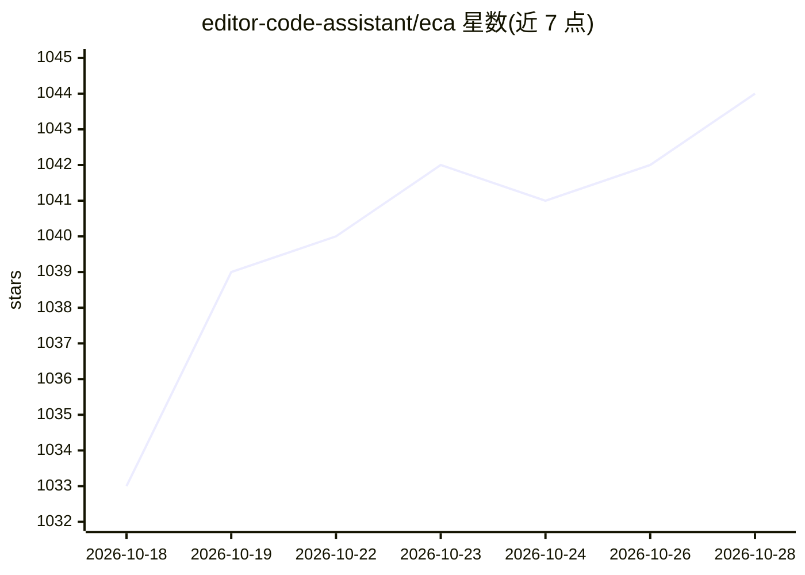

# editor-code-assistant/eca

⭐ 1,044 · Clojure · Apache-2.0 · 推送 2026-10-27 · [GitHub](https://github.com/editor-code-assistant/eca) · [官网](http://eca.dev) · 组织维护

**编辑器无关的 AI 结对编程服务器：为任意编辑器接入 LLM**

用 Clojure 编写的编辑器无关服务器，参考 LSP 协议通过 stdin/stdout 与编辑器通信，提供聊天、改写与代码补全功能，由编辑器插件在启动时自动下载并运行。支持配置多个 agent/subagent、OpenAI/Anthropic/Copilot/Ollama 等多种模型、MCP 资源与提示的上下文注入，并可通过 OpenTelemetry 导出工具与提示的使用指标。已有 Emacs、VSCode、Vim、IntelliJ 与桌面端插件，配置一次即可在各编辑器间共用。

## 筛选速览

| 维度 | 判定 | 备注 |
|---|---|---|
| AI 角色 | `ai-ecosystem` | LLM/agent 周边工具 |
| 许可风险 | `permissive` | Apache-2.0 |
| 部署形态 | `None` |  |
| 模型依赖 | local-ok | 支持本地模型 |
| 硬件要求 | — | 无带数字的原话,不猜 |
| 安装摩擦 | `low` | 无编译、无系统依赖或容器化 |
| 成熟度 | — | 结构信号不足 |

## 能力要点

- 编辑器无关协议，编辑器经 `eca server` 以 stdin/stdout 通信
- 聊天/改写/补全功能，可配置多个 agent 与不同模型
- 支持 OpenAI、Anthropic、Copilot、Ollama 本地模型等多种 provider
- OpenTelemetry 导出工具、提示与服务器使用指标

## 适用场景

- 在 Emacs/Vim 等编辑器中获得统一的 AI 结对编程体验
- 团队跨编辑器共享同一套 AI 编程配置
- 接入本地 Ollama 模型做补全与聊天

## 场景标签

`代码生成` · 领域:编码与开发

## 证据(README 行号)

> L25: - :page_facing_up: **Editor-agnostic**: protocol for any editor to integrate.
> L35: A Free and OpenSource editor-agnostic tool that aims to easily link LLMs <-> Editors, giving the best UX possible f
> L46: **How it works**: Editors spawn the server via `eca server` and communicate via stdin/stdout, similar to LSPs. Supp

## 星数曲线

2026-10-18 1,033 → 2026-10-28 1,044（+11）

---
*卡片 v1 · prompt 1.4 · 生成 2026-10-21 · 置信度 high · 依据 README sha `33aee426e562` · [字段定义](../../DATASET.md)*
