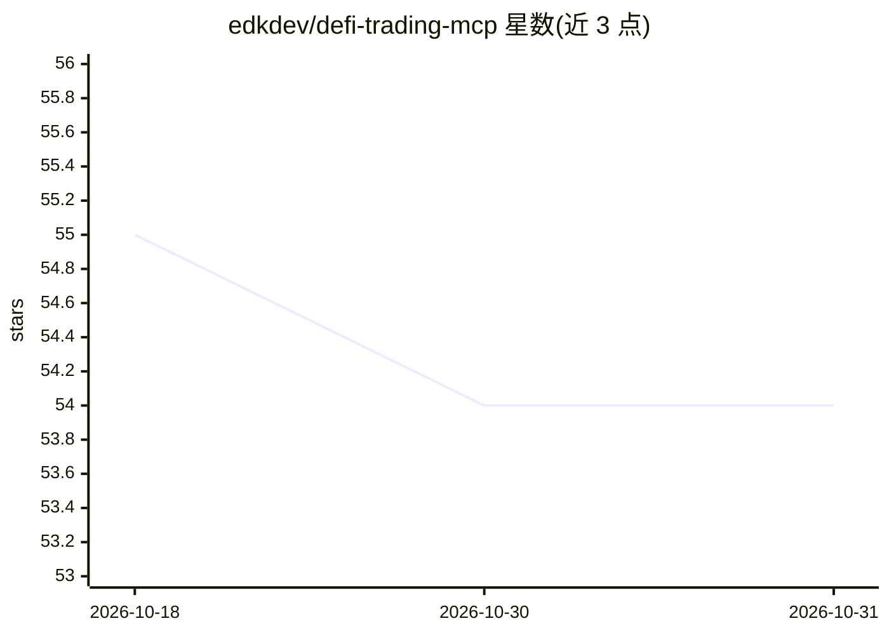

# edkdev/defi-trading-mcp

⭐ 54 · JavaScript · 推送 2026-06-10 · [GitHub](https://github.com/edkdev/defi-trading-mcp) · 个人维护

**把 AI 助手接入 DeFi 交易的 MCP 服务器（17+ 链）**

面向 MCP 客户端（Claude Code、Claude Desktop、Cursor、Kiro 等）的 DeFi 交易工具服务器：提供 40+ 工具，覆盖多链组合查询、行情与 OHLCV 分析、跨 DEX 报价与 swap 执行、gasless 交易与 MEV 保护，支持 17+ 条 EVM 链。私钥本地保存、交易本地签名，需配置钱包私钥、地址与 CoinGecko API key（Alchemy 可选）。通过 npm 全局安装并用 npx 运行。

## 筛选速览

| 维度 | 判定 | 备注 |
|---|---|---|
| AI 角色 | `ai-ecosystem` | LLM/agent 周边工具 |
| 许可风险 | `none` | — |
| 部署形态 | `library` | 以包/库形式分发 |
| 模型依赖 | — | README 未给出锁定关系 |
| 硬件要求 | — | 无带数字的原话,不猜 |
| 安装摩擦 | `low` | 无编译、无系统依赖或容器化 |
| 成熟度 | — | 结构信号不足 |

## 能力要点

- 40+ 交易与分析工具（组合、行情、OHLCV、swap、gasless）
- 支持 17+ 条区块链网络
- 私钥本地保存、交易本地签名，以太坊交易带 MEV 保护
- 提供 Claude Code / Claude Desktop / Cursor / Kiro 等客户端配置步骤

## 适用场景

- 让 AI 助手查询并分析我的多链 DeFi 组合
- 通过对话获取报价并执行跨 DEX swap 或 gasless 交易
- 扫描新发射代币并做技术与风险评估
- 设置仓位回撤监控与止损提示

## 场景标签

`金融量化` · 领域:学习与行业

## 证据(README 行号)

> L1: # DeFi Trading Agent MCP Server
> L3: Transform your AI assistant into an autonomous crypto trading agent with real-time market analysis, portfolio manage
> L61: npm install -g defi-trading-mcp

## 星数曲线

2026-10-18 55 → 2026-10-31 54（-1）

---
*卡片 v1 · prompt 1.4 · 生成 2026-10-24 · 置信度 high · 依据 README sha `1a732ab5a090` · [字段定义](../../DATASET.md)*
