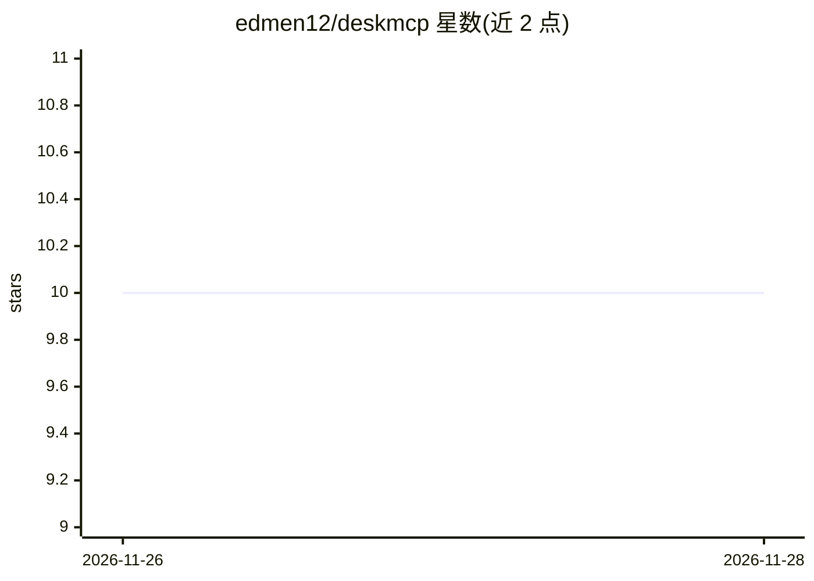

# edmen12/deskmcp

⭐ 10 · TypeScript · Apache-2.0 · 推送 2026-11-13 · [GitHub](https://github.com/edmen12/deskmcp) · [官网](https://edmen12.github.io/deskmcp/) · 个人维护

**让 ChatGPT 受控访问本地文件与终端的 MCP 策略网关**

运行在用户电脑上的本地优先 MCP 策略网关，为 ChatGPT 提供受控访问本地文件、终端会话与 Windows 桌面 UI 的能力。通过 OpenAI Tunnel 连接，本地端点绑定 127.0.0.1；默认 Read-only 配置，文件访问限定于用户选定的工作区，敏感路径默认排除。暴露稳定的 27 个 MCP 工具，凭能力（capability）机制控制文件与进程操作，Full/Unlock 等高危配置仅会话内有效不持久化。Windows 提供自包含安装包，无需 Node.js/.NET/Git。

## 筛选速览

| 维度 | 判定 | 备注 |
|---|---|---|
| AI 角色 | `ai-ecosystem` | LLM/agent 周边工具 |
| 许可风险 | `permissive` | Apache-2.0 |
| 部署形态 | `desktop` | 安装包/桌面程序 |
| 模型依赖 | — | README 未给出锁定关系 |
| 硬件要求 | — | 无带数字的原话,不猜 |
| 安装摩擦 | `medium` | 含编译或系统依赖之一 |
| 成熟度 | — | 结构信号不足 |

## 能力要点

- 27 个稳定 MCP 工具面，schema 跨配置可发现，调用仍经本地策略检查
- 四级权限配置（Read/Write/Full/Unlock），高危档不持久化
- 能力机制：一次性 observation_id、路径/版本绑定、序列化防并发覆盖
- Windows Computer Use 以 UI Automation 优先，Agent Desktop 池支持多代理并行

## 适用场景

- 让 ChatGPT 在指定工作区内读写本地文件
- 通过对话驱动终端会话与 Windows 桌面自动化任务
- 多聊天窗口并行运行受隔离的任务（Task Room）

## 场景标签

`GUI 自动化` · 领域:效率与自动化

## 证据(README 行号)

> L11: **DeskMCP is an open-source local-first MCP policy gateway that gives ChatGPT controlled access to local files, ter
> L52: DeskMCP Gateway  (127.0.0.1:8765)

## 星数曲线

2026-11-26 10 → 2026-11-28 10（+0）

---
*卡片 v1 · prompt 1.4 · 生成 2026-11-26 · 置信度 mid · 依据 README sha `19a76a788114` · [字段定义](../../DATASET.md)*
