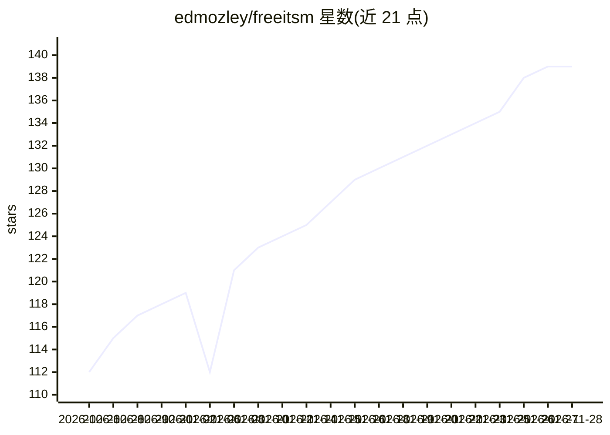

# edmozley/freeitsm

⭐ 139 · PHP · MIT · 推送 2026-11-25 · [GitHub](https://github.com/edmozley/freeitsm) · [官网](https://freeitsm.co.uk) · 个人维护

**面向 IT 团队的自托管免费 ITSM 平台，含 24 个模块**

基于 PHP 8.1–8.4 + MySQL 8.0 的自托管 IT 服务管理平台，提供 24 个集成模块（工单、资产、知识库、变更、问题、任务、CMDB、工作流、LMS 等）与终端用户自助门户。AI 功能包括回复清理、知识问答、表单生成、课程编写、RCA 草拟，采用自带密钥或本地模型服务器接入，无云端回退。支持 Docker 或 WAMP/XAMPP/LAMP 手动安装，MIT 许可、无按席位收费。

## 筛选速览

| 维度 | 判定 | 备注 |
|---|---|---|
| AI 角色 | `ai-enhanced` | 去掉 AI 部分产品仍成立 |
| 许可风险 | `permissive` | MIT |
| 部署形态 | `self-host` | docker 或自建部署 |
| 模型依赖 | local-ok | 支持本地模型 |
| 硬件要求 | — | 无带数字的原话,不猜 |
| 安装摩擦 | `low` | 无编译、无系统依赖或容器化 |
| 成熟度 | — | 结构信号不足 |

## 能力要点

- 24 个集成模块覆盖工单、资产、CMDB、知识库、工作流、LMS 等
- AI 功能自带密钥接入（Anthropic/OpenAI/OpenRouter/Azure）或本地模型（Ollama/LM Studio/vLLM）
- 多渠道转工单：邮件、WhatsApp、Telegram、Slack、Teams、Mattermost、网页聊天组件
- Docker 一键部署，MIT 许可无按席位费用

## 适用场景

- 企业内部搭建自托管 IT 服务台与工单系统
- 管理 IT 资产与 CMDB 配置项
- 为终端用户提供自助服务门户与知识库
- 通过本地模型服务器保持数据在内网使用 AI 功能

## 场景标签

`工作流自动化` `知识库管理` · 领域:效率与自动化

## 证据(README 行号)

> L16: FreeITSM is a complete web-based ITSM platform: **24 integrated modules** covering tickets, assets, knowledge, chan
> L22: - 🤖 **AI included, not upsold** — reply cleanup, knowledge Q&A, form generation, course authoring, RCA drafting and

## 星数曲线

2026-10-26 112 → 2026-11-28 139（+27）

---
*卡片 v1 · prompt 1.4 · 生成 2026-11-27 · 置信度 high · 依据 README sha `56462a5a4e8f` · [字段定义](../../DATASET.md)*
