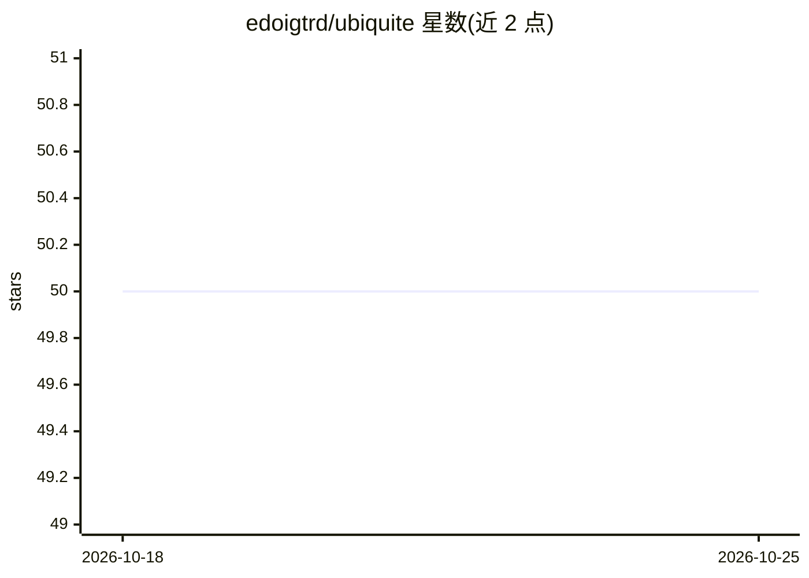

# edoigtrd/ubiquite

⭐ 50 · TypeScript · AGPL-3.0 · 推送 2025-11-14 · [GitHub](https://github.com/edoigtrd/ubiquite) · 个人维护

**开源 Perplexity 克隆：多 LLM 供应商的联网搜索问答应用**

自托管的 AI 搜索问答 Web 应用，功能对标 Perplexity：通过 SearX 实例联网搜索、流式回答、KaTeX 数学渲染、图片搜索（CLIP 重排序）、生成 GeoJSON 交互地图的 Map Tool、可自定义 Focus 模式与提示词。支持 anthropic、groq、mistral、openai（含兼容端点）与 ollama 等供应商，模型预设可在单一 toml 配置文件中统一管理并从 UI 编辑。架构为 FastAPI 后端 + React 前端，LLM 调用经 LangChain，数据库用 SQLite/SQLModel，通过 Docker Compose 部署。

## 筛选速览

| 维度 | 判定 | 备注 |
|---|---|---|
| AI 角色 | `ai-native` | 本体是模型或模型工具 |
| 许可风险 | `viral` | AGPL-3.0 |
| 部署形态 | `self-host` | docker 或自建部署 |
| 模型依赖 | local-ok | 支持本地模型 |
| 硬件要求 | — | 无带数字的原话,不猜 |
| 安装摩擦 | `low` | 无编译、无系统依赖或容器化 |
| 成熟度 | — | 结构信号不足 |

## 能力要点

- 多 LLM 供应商接入（anthropic/groq/mistral/openai 兼容端点/ollama），单一 toml 配置文件统一管理
- Map Tool：LLM 生成 GeoJSON 并渲染交互地图，可配置 geopy 地理编码器
- 图片搜索带 CLIP 模型重排序（ClipReranker）
- Focus 模式支持任意 SearX 搜索语法限定查询范围

## 适用场景

- 自建带引用来源的联网 AI 搜索问答服务
- 在不同 LLM 供应商与模型预设间切换使用
- 需要数学公式渲染与地图问答的技术问答场景

## 场景标签

`RAG` · 领域:知识与检索

## 证据(README 行号)

> L3: > Ubiquité is an open-source Perplexity clone.
> L20: - Multiple LLM providers (OpenAI, Mistral, Groq, Nous, XAI)
> L161: The map tool (my personal favorite feature) allows the LLM to answer geolocation-related questions by generating a

## 星数曲线

2026-10-18 50 → 2026-10-25 50（+0）

---
*卡片 v1 · prompt 1.4 · 生成 2026-10-24 · 置信度 high · 依据 README sha `c5289f49fe43` · [字段定义](../../DATASET.md)*
