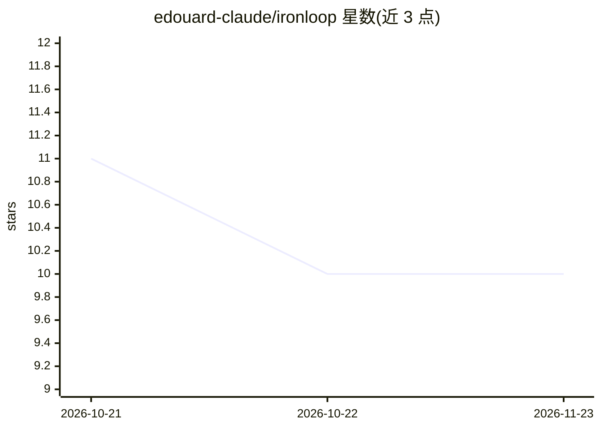

# edouard-claude/ironloop

⭐ 10 · Shell · MIT · 推送 2026-09-11 · [GitHub](https://github.com/edouard-claude/ironloop) · 个人维护

**给 AI 辅助开发者的五层验证工程规范与技能包**

IRONLOOP 是一套面向 AI 辅助开发的验证优先软件工程系统，以 Agent Skills 规格（SKILL.md）形式分发。它定义 SPEC→GEN→TEST→SIM→PENTEST 五层自动化验证流程与

## 筛选速览

| 维度 | 判定 | 备注 |
|---|---|---|
| AI 角色 | `ai-ecosystem` | LLM/agent 周边工具 |
| 许可风险 | `permissive` | MIT |
| 部署形态 | `library` | 以包/库形式分发 |
| 模型依赖 | — | README 未给出锁定关系 |
| 硬件要求 | — | 无带数字的原话,不猜 |
| 安装摩擦 | `low` | 无编译、无系统依赖或容器化 |
| 成熟度 | — | 结构信号不足 |

## 能力要点

- 五层验证流程：SPEC/GEN/TEST/SIM/PENTEST
- 记录每层 token 消耗并在 PR 携带生成/验证比例
- 仅针对 Rust 目标语言（编译器强反馈）
- LLM-agnostic：兼容 Claude Code、OpenAI Codex、Gemini CLI、Cursor

## 适用场景

- AI 生成代码的新项目从第一天起建立五层验证
- 对遗留代码渐进式补测试与规格再重写为 Rust
- 按 Agent Skills 标准为编码 agent 加载工程流程指引

## 场景标签

`编码 Agent` `网络安全` · 领域:编码与开发

## 证据(README 行号)

> L10: IRONLOOP is a **verification-first software engineering system** for
> L173: IRONLOOP follows the Agent Skills open specification:
> L178: - **LLM-agnostic**: works with Claude Code, OpenAI Codex, Gemini CLI, Cursor, and any agent supporting the Agent S

## 星数曲线

2026-10-21 11 → 2026-11-23 10（-1）

---
*卡片 v1 · prompt 1.4 · 生成 2026-11-19 · 置信度 high · 依据 README sha `25b347f282fc` · [字段定义](../../DATASET.md)*
