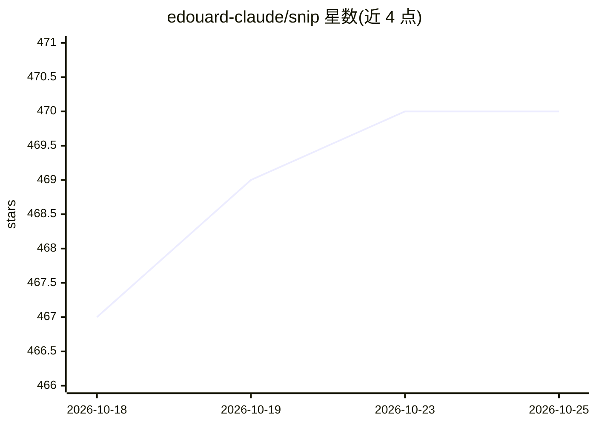

# edouard-claude/snip

⭐ 472 · Go · MIT · 推送 2026-10-22 · [GitHub](https://github.com/edouard-claude/snip) · [官网](https://edouard-claude.github.io/snip/) · 个人维护

**过滤 shell 输出以减少 AI 编码助手 token 消耗的 CLI 代理**

用 Go 编写的 CLI 代理，置于 AI 编码助手与 shell 之间：拦截 shell 命令输出，经声明式 YAML 过滤管道压缩后再送入助手上下文窗口，README 实测会话称节省 60-90% token。内置 132 个过滤器和 20 种管道动作，覆盖 git、go、cargo、npm、docker、kubectl 等命令。通过 `snip init` 以原生 hook 或提示注入方式接入 Claude Code、Cursor、Copilot、Gemini CLI、Codex、Aider 等十余种工具，也可独立或经 shell 别名使用；未匹配的命令原样透传。

## 筛选速览

| 维度 | 判定 | 备注 |
|---|---|---|
| AI 角色 | `ai-ecosystem` | LLM/agent 周边工具 |
| 许可风险 | `permissive` | MIT |
| 部署形态 | `self-host` | docker 或自建部署 |
| 模型依赖 | — | README 未给出锁定关系 |
| 硬件要求 | — | 无带数字的原话,不猜 |
| 安装摩擦 | `low` | 无编译、无系统依赖或容器化 |
| 成熟度 | — | 结构信号不足 |

## 能力要点

- 声明式 YAML 过滤器，过滤器是数据文件而非编译代码
- 内置 132 个过滤器覆盖 100 种命令、20 种管道动作
- `snip init` 一条命令接入 Claude Code、Cursor、Codex 等 14 种 AI 编码工具
- 未匹配命令零开销透传，`snip gain` 输出节省报告

## 适用场景

- 减少 AI 编码助手会话中的 shell 输出 token 消耗
- 让 Claude Code/Cursor/Codex 等工具自动压缩测试与 git 输出
- 自定义 YAML 管道压缩特定项目命令的输出

## 场景标签

 · 领域:开发者工具/LLM 基础设施

## 证据(README 行号)

> L8: **CLI proxy that filters shell output before it reaches your AI coding assistant's context window.** Works with Clau
> L12: snip sits between your AI tool and the shell, filtering output through **declarative YAML pipelines**. Write a YAML
> L114: |**Claude Code**|`snip init`|PreToolUse hook (native)|

## 星数曲线

2026-10-18 467 → 2026-10-25 470（+3）

---
*卡片 v1 · prompt 1.4 · 生成 2026-10-22 · 置信度 mid · 依据 README sha `454a8d21e905` · [字段定义](../../DATASET.md)*
