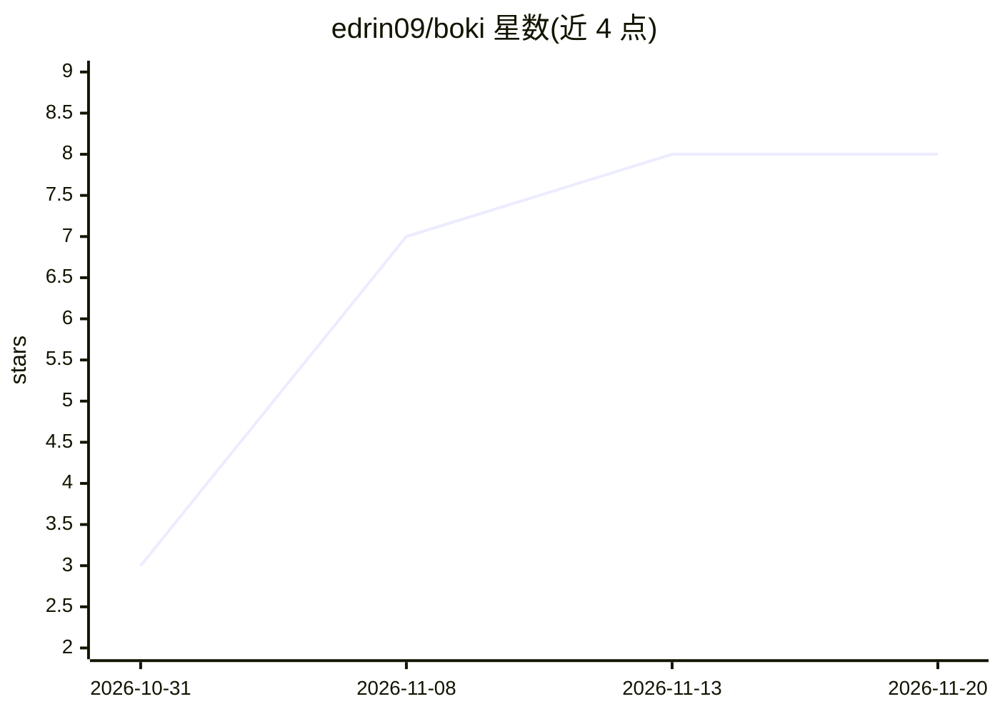

# edrin09/boki

⭐ 8 · TypeScript · AGPL-3.0 · 推送 2026-11-18 · [GitHub](https://github.com/edrin09/boki) · [官网](https://edrin09.github.io/boki/) · 个人维护 · 中文 README

**离线优先的开源财务软件，AI 帮小微企业记账**

一套装在本机的复式记账软件：凭证录入、报表、期末结转、多公司管理，14 个官方插件按需安装。AI 部分提供一句话记账等七类操作、本地 OCR 发票识别与本地语音识别，模型通过 OpenAI 兼容协议接入（本地 Ollama/llama.cpp 或云端 API）；所有 AI 写入只生成草稿凭证，经人工审核才入账，并提供只读 MCP 供外部 AI 客户端查询。SQLCipher 整库加密，默认零外传，断网可用。Windows 提供安装包，也可源码运行。

## 筛选速览

| 维度 | 判定 | 备注 |
|---|---|---|
| AI 角色 | `ai-enhanced` | 去掉 AI 部分产品仍成立 |
| 许可风险 | `dual` | AGPL-3.0 |
| 部署形态 | `desktop` | 安装包/桌面程序 |
| 模型依赖 | local-ok | 支持本地模型 |
| 硬件要求 | — | 无带数字的原话,不猜 |
| 安装摩擦 | `low` | 无编译、无系统依赖或容器化 |
| 成熟度 | — | 结构信号不足 |

## 能力要点

- 一句话办七类财务操作，AI 只生成草稿，人工审核后入账
- 本地 OCR + 本地语音识别 + 本地大模型三件套，AI 全链路可离线
- 只读 MCP 供 Claude Desktop、Cursor 等外部客户端查账
- SQLCipher 整库加密 + RBAC + 审计日志，零外传

## 适用场景

- 小微企业/个体工商户离线记账出报表
- 代理记账公司一个账号管理多家公司账套
- 数据不出内网的团队用本地模型做 AI 记账
- 发票 PDF/扫描件自动识别生成凭证草稿

## 场景标签

`OCR` · 领域:感知与多模态

## 证据(README 行号)

> L23: **一套装在自己电脑上的开源财务软件：录入凭证、出报表、管多家公司，AI 帮你记账，数据库整库加密，断网也能用。**
> L27: - **AI 怎么放**：**接口全开，落点收紧**——模型随你换（本地 / 内网 / 云端）、一句话随便说、外部 AI 客户端可接；但所有写入只落草稿，人点了才生效

## 星数曲线

2026-10-31 3 → 2026-11-20 8（+5）

---
*卡片 v1 · prompt 1.4 · 生成 2026-11-20 · 置信度 high · 依据 README sha `b4e7a1fb403c` · [字段定义](../../DATASET.md)*
