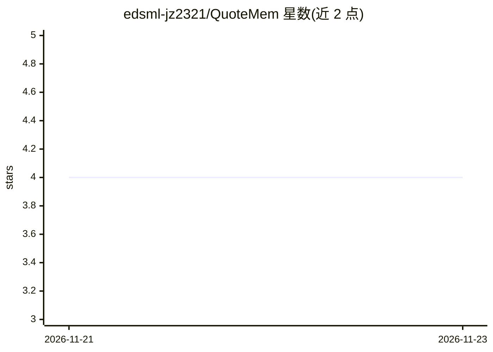

# edsml-jz2321/QuoteMem

⭐ 4 · Python · MIT · 推送 2026-11-20 · [GitHub](https://github.com/edsml-jz2321/QuoteMem) · [官网](https://agentmemoryleaderboard.ai/results/cycle-2/#industry-textual) · 个人维护

**为对话 agent 提供可审计长期记忆的 HTTP 服务**

以 HTTP 服务形式为对话式 agent 提供长期记忆存储：每条记忆附带 UTF-8 字节区间的原文引用，可经 /memory/why 回溯证据；更新写入新版本并关闭旧版本，保留可读历史；遗忘采用两步 prepare/confirm 并留墓碑防止重存；写入前经 review 步骤比对既有记忆并记录决策快照以便重放审查。默认 lean-local 确定性本地规则审查，full 模式交由 judge 模型。依赖 Python 3.12 与 uv，数据由 HeavenBase 存储。

## 筛选速览

| 维度 | 判定 | 备注 |
|---|---|---|
| AI 角色 | `ai-ecosystem` | LLM/agent 周边工具 |
| 许可风险 | `permissive` | MIT |
| 部署形态 | `library` | 以包/库形式分发 |
| 模型依赖 | — | README 未给出锁定关系 |
| 硬件要求 | — | 无带数字的原话,不猜 |
| 安装摩擦 | `low` | 无编译、无系统依赖或容器化 |
| 成熟度 | `idea` | |

## 能力要点

- 每条记忆绑定精确 UTF-8 字节区间的原文引用，可回溯证据
- 版本化取代机制，历史经 /memory/history 可读
- 两步遗忘并留墓碑，阻止遗忘内容被再次写入
- review 决策连同邻居快照存储，可审计与重放

## 适用场景

- 为对话 agent 接入带出处可核查的长期记忆
- 需要事实变更保留版本历史的知识记忆场景
- 用户要求 agent 遗忘特定信息并防止其回流
- 复现与诊断 AMLB 等记忆基准的评测结果

## 场景标签

`Agent 记忆` · 领域:Agent 开发

## 证据(README 行号)

> L3: QuoteMem is an auditable long-term memory service for conversational agents.
> L22:  audited and replayed.

## 星数曲线

2026-11-21 4 → 2026-11-23 4（+0）

---
*卡片 v1 · prompt 1.4 · 生成 2026-11-21 · 置信度 mid · 依据 README sha `1f54d7a823a7` · [字段定义](../../DATASET.md)*
