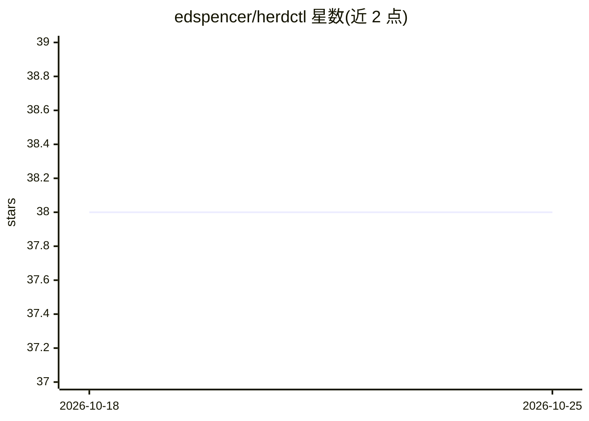

# edspencer/herdctl

⭐ 38 · TypeScript · MIT · 推送 2026-10-23 · [GitHub](https://github.com/edspencer/herdctl) · [官网](https://herdctl.dev) · 个人维护

**Claude Code 代理编排层：定时调度、Docker 隔离与 Discord/Slack 对话**

基于 Claude Agents SDK 的 Claude Code 会话编排工具：用 .yml 配置定义代理，按 schedules 定时、webhook 或聊天消息触发 Claude Code 会话，可组成多项目代理舰队统一启动。提供两种运行时（CLI 走 Claude Max 订阅、SDK 走 API 计价），支持 Docker 隔离、资源与网络控制；代理可接入 Discord/Slack 对话，任务产生真实 SDK 会话可 claude --resume 续接。npm 全局安装，附 Web 仪表盘与多个子包。

## 筛选速览

| 维度 | 判定 | 备注 |
|---|---|---|
| AI 角色 | `ai-ecosystem` | LLM/agent 周边工具 |
| 许可风险 | `permissive` | MIT |
| 部署形态 | `library` | 以包/库形式分发 |
| 模型依赖 | locked-api |  |
| 硬件要求 | — | 无带数字的原话,不猜 |
| 安装摩擦 | `low` | 无编译、无系统依赖或容器化 |
| 成熟度 | — | 结构信号不足 |

## 能力要点

- .yml 配置定义代理，按 schedules/webhook/聊天消息触发
- 两种运行时：CLI 走 Claude Max 订阅，SDK 走 API 计价
- Docker 隔离运行，含资源限制与网络控制
- Discord/Slack 连接器与 Web 仪表盘（实时监控、聊天、任务管理）

## 适用场景

- 定时自动执行 Claude Code 任务（如定时 PR 审查）
- 在 Discord/Slack 里与代理对话并让其继续工作
- 用一条命令统一启动多个项目的代理舰队

## 场景标签

`编码 Agent` `Agent 框架` · 领域:Agent 开发

## 证据(README 行号)

> L23: **herdctl** is an orchestration layer for Claude Code. Under the hood, it uses the Claude Agents SDK to trigger Cla
> L37: - **Full Claude Code Power** — If Claude Code can do it, your herdctl agent can do it. Same tools, same MCP servers
> L39: - **Two Runtimes** — CLI runtime uses your Claude Max subscription (much cheaper per token). SDK runtime uses API p

## 星数曲线

2026-10-18 38 → 2026-10-25 38（+0）

---
*卡片 v1 · prompt 1.4 · 生成 2026-10-25 · 置信度 high · 依据 README sha `748b4eb20ae7` · [字段定义](../../DATASET.md)*
