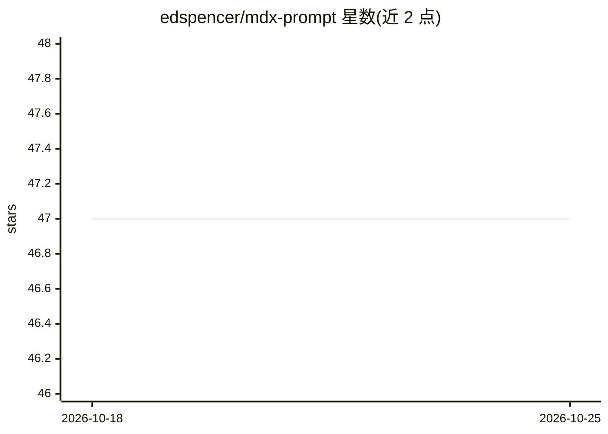

# edspencer/mdx-prompt

⭐ 47 · TypeScript · MIT · 推送 2025-10-29 · [GitHub](https://github.com/edspencer/mdx-prompt) · [官网](https://edspencer.net/projects) · 个人维护

**用 JSX/MDX 组件编写与组合 LLM 提示词的 React 库**

面向 React 开发者的轻量库：以 JSX 组件或 .mdx 文件定义 LLM 提示词，通过 react-dom/server 渲染为可发送给 LLM API 的最终字符串。提供 Prompt、Purpose、Instructions、Tools、ChatHistory 等默认结构组件，支持组件复用、props 传参、混排自由文本与结构化标签，可在 Next.js、Node.js CLI 等服务端 React 环境运行；提供 renderMDX 与 renderMDXPromptFile 两个渲染入口。需 React 18+ 作为 peer 依赖，npm/yarn/pnpm 安装。

## 筛选速览

| 维度 | 判定 | 备注 |
|---|---|---|
| AI 角色 | `ai-ecosystem` | LLM/agent 周边工具 |
| 许可风险 | `permissive` | MIT |
| 部署形态 | `library` | 以包/库形式分发 |
| 模型依赖 | — | README 未给出锁定关系 |
| 硬件要求 | — | 无带数字的原话,不猜 |
| 安装摩擦 | `low` | 无编译、无系统依赖或容器化 |
| 成熟度 | — | 结构信号不足 |

## 能力要点

- 以 JSX/MDX 组件编写可组合、可复用的 LLM 提示词
- 内置 Purpose/Instructions/Tools/ChatHistory 等结构组件
- renderMDX 内联渲染与 renderMDXPromptFile 文件渲染两种入口
- 可在 Next.js 路由或 Node.js CLI 中生成提示词字符串

## 适用场景

- 在 React/Next.js 项目中以组件方式维护复杂 LLM 提示词
- 将提示词片段封装为组件在多个 prompt 间复用
- 为测试与 Eval 提供喂 mock 数据的结构化提示词

## 场景标签

`提示工程` · 领域:Agent 开发

## 证据(README 行号)

> L5: `mdx-prompt` is a lightweight library enabling React (and MDX) developers to write large language model (LLM) prompt
> L45: Then, `mdx-prompt` transforms that JSX/MDX into a final string suitable for sending to an LLM API.

## 星数曲线

2026-10-18 47 → 2026-10-25 47（+0）

---
*卡片 v1 · prompt 1.4 · 生成 2026-10-25 · 置信度 high · 依据 README sha `2068ad533f5b` · [字段定义](../../DATASET.md)*
