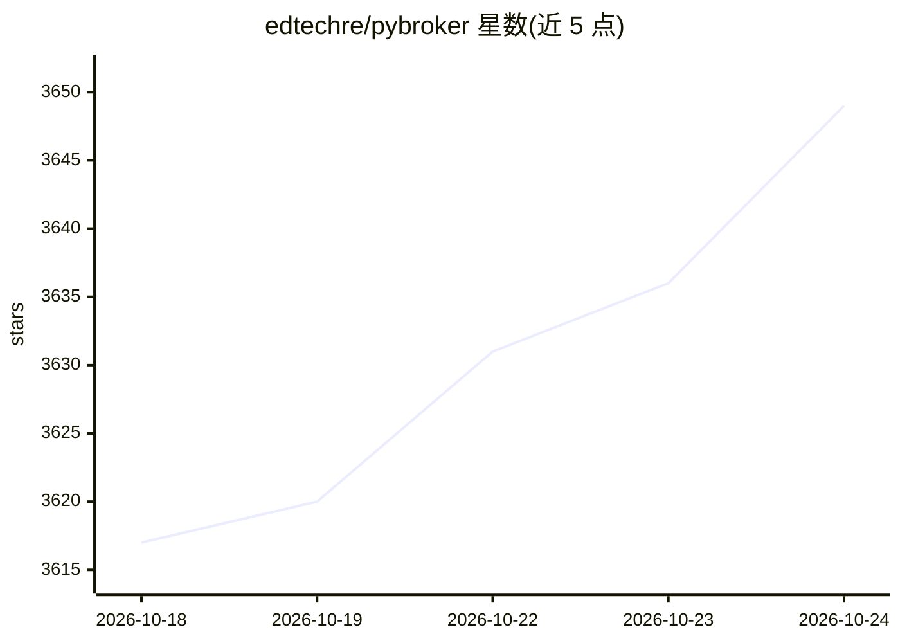

# edtechre/pybroker

⭐ 3,653 · Python · NOASSERTION · 推送 2026-10-20 · [GitHub](https://github.com/edtechre/pybroker) · [官网](https://www.pybroker.com) · 个人维护

**Python 机器学习算法交易框架：策略开发与回测**

用于开发算法交易策略的 Python 框架，重点支持结合机器学习的策略：基于 NumPy 和 Numba 构建回测引擎，支持多品种规则与模型策略、多时间周期信号整合，可从 Alpaca、Yahoo Finance、AKShare 或自有数据源获取历史数据。提供 Walkforward Analysis 训练与回测、bootstrap 随机化交易指标、Optuna 参数优化、数据/指标/模型缓存与并行计算。v2 新增面向编码 agent 的 Agent Skills（策略创建、指标编写、模型训练等）。要求 Python 3.11+，许可为 Apache 2.0 with Commons Clause。

## 筛选速览

| 维度 | 判定 | 备注 |
|---|---|---|
| AI 角色 | `ai-ecosystem` | LLM/agent 周边工具 |
| 许可风险 | `none` | NOASSERTION |
| 部署形态 | `library` | 以包/库形式分发 |
| 模型依赖 | — | README 未给出锁定关系 |
| 硬件要求 | — | 无带数字的原话,不猜 |
| 安装摩擦 | `low` | 无编译、无系统依赖或容器化 |
| 成熟度 | — | 结构信号不足 |

## 能力要点

- NumPy + Numba 构建的回测引擎，支持并行计算与训练
- Walkforward Analysis 模拟实盘表现的训练与回测
- Alpaca/Yahoo Finance/AKShare 等多数据源接入
- v2 提供面向 AI 编码 agent 的 Agent Skills

## 适用场景

- 用机器学习模型开发和回测交易策略
- 通过 Walkforward Analysis 评估策略在实盘情境下的表现
- 让编码 agent 借助 Agent Skills 编写策略与回测代码

## 场景标签

`金融量化` · 领域:学习与行业

## 证据(README 行号)

> L14: machine learning? **PyBroker** is a Python framework
> L16: strategies that use machine learning. With PyBroker, you can easily create and
> L26: * Model training and backtesting using Walkforward Analysis, which simulates how the strategy would perform during 

## 星数曲线

2026-10-18 3,617 → 2026-10-24 3,649（+32）

---
*卡片 v1 · prompt 1.4 · 生成 2026-10-20 · 置信度 mid · 依据 README sha `f711ca19d5ac` · [字段定义](../../DATASET.md)*
