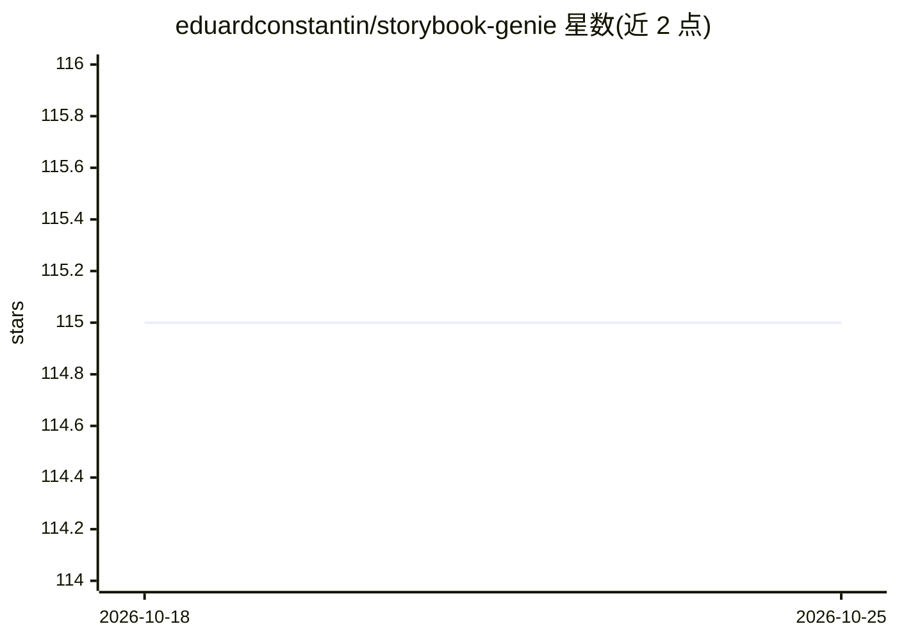

# eduardconstantin/storybook-genie

⭐ 115 · JavaScript · MIT · 推送 2026-04-01 · [GitHub](https://github.com/eduardconstantin/storybook-genie) · 个人维护

**开发者 CLI 工具：将 React 组件文件转换为 Storybook 故事**

面向使用 Storybook 的前端开发者的命令行工具：读取包含 React 组件的文件，调用 GPT 模型生成对应的 .story.js 故事文件。支持选择 OpenAI 或本地 Ollama 作为后端（Ollama 无需 API key，但需本地运行 Ollama 服务并拉取模型）。提供文件选择交互、自定义故事模板、默认路径配置（storybook-genie.config.json）与代码美化。通过 npm 安装，npx storybook-genie 运行，依赖数量少。

## 筛选速览

| 维度 | 判定 | 备注 |
|---|---|---|
| AI 角色 | `ai-native` | 本体是模型或模型工具 |
| 许可风险 | `permissive` | MIT |
| 部署形态 | `library` | 以包/库形式分发 |
| 模型依赖 | local-ok | 支持本地模型 |
| 硬件要求 | — | 无带数字的原话,不猜 |
| 安装摩擦 | `low` | 无编译、无系统依赖或容器化 |
| 成熟度 | — | 结构信号不足 |

## 能力要点

- 将 React 组件文件生成为 Storybook 故事（.story.js）
- 支持 OpenAI 与本地 Ollama 两种 AI 后端（Ollama 免 API key）
- 可配置默认后端、模型、路径与自定义故事模板
- 依赖数量少，npm 安装、npx 运行

## 适用场景

- 为已有 React 组件批量生成 Storybook 故事文件
- 无 API key 时用本地 Ollama 模型生成故事
- 通过自定义模板控制生成故事的格式

## 场景标签

`代码生成` · 领域:编码与开发

## 证据(README 行号)

> L3: Storybook Genie is a command line interface tool that can be used to convert files that contain React components int
> L16: - Select preferred GPT model (OpenAI or Ollama)

## 星数曲线

2026-10-18 115 → 2026-10-25 115（+0）

---
*卡片 v1 · prompt 1.4 · 生成 2026-10-23 · 置信度 high · 依据 README sha `c442360af711` · [字段定义](../../DATASET.md)*
