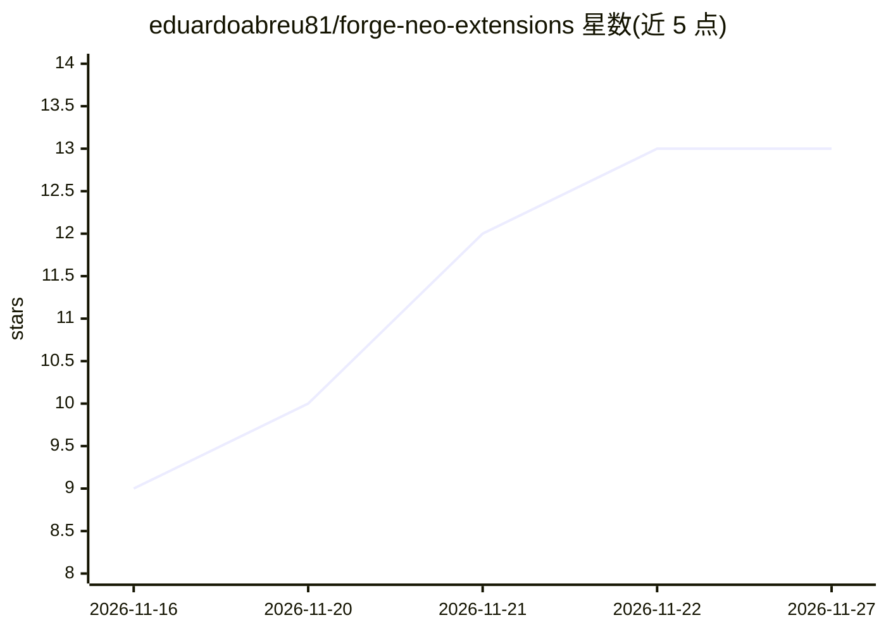

# eduardoabreu81/forge-neo-extensions

⭐ 13 · Python · MIT · 推送 2026-11-25 · [GitHub](https://github.com/eduardoabreu81/forge-neo-extensions) · 个人维护

**为 Forge Neo WebUI 提供默认的扩展索引清单**

Stable Diffusion WebUI Forge Neo 的默认扩展索引：以 AUTOMATIC1111 经典索引为基础移除失效条目，并为 Forge Neo 生态的扩展添加 🟢 标记与 forge-neo 标签。自 2026 年 11 月起由 Forge Neo 的 Extensions → Available 标签页内置加载，旧版本可通过粘贴 index.json URL 或设置 WEBUI_EXTENSIONS_INDEX 环境变量使用。条目按修复、提示词、LoRA、采样器、放大等约 12 个类别组织，索引按月更新。扩展由第三方提供，README 提示安装前检查其仓库。

## 筛选速览

| 维度 | 判定 | 备注 |
|---|---|---|
| AI 角色 | `ai-knowledge` | 知识聚合/清单类 |
| 许可风险 | `permissive` | MIT |
| 部署形态 | `None` |  |
| 模型依赖 | — | README 未给出锁定关系 |
| 硬件要求 | — | 无带数字的原话,不猜 |
| 安装摩擦 | `low` | 无编译、无系统依赖或容器化 |
| 成熟度 | — | 结构信号不足 |

## 能力要点

- 在经典 A1111 索引基础上移除失效条目并附加 forge-neo 标记
- 通过 forge-neo 标签过滤仅显示 Neo 生态扩展
- 支持 WEBUI_EXTENSIONS_INDEX 环境变量自定义索引来源
- 索引按月更新，条目按约 12 个功能类别组织

## 适用场景

- 在 Forge Neo 中浏览并安装社区扩展
- 筛选出兼容 Forge Neo 的扩展列表
- 为自己开发的 Forge Neo 扩展提交收录

## 场景标签

`精选清单` · 领域:学习与行业

## 证据(README 行号)

> L8: > **The default extension index of Stable Diffusion WebUI Forge - Neo**
> L10: Since **15 November 2026** (`e67193d9`, *rewrite Extensions tab*), the **Extensions → Available** tab in Forge Neo 

## 星数曲线

2026-11-16 9 → 2026-11-27 13（+4）

---
*卡片 v1 · prompt 1.4 · 生成 2026-11-20 · 置信度 high · 依据 README sha `59ac46b12087` · [字段定义](../../DATASET.md)*
