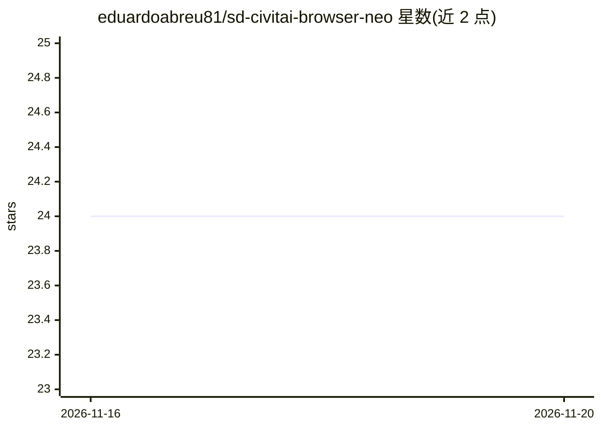

# eduardoabreu81/sd-civitai-browser-neo

⭐ 24 · Python · AGPL-3.0 · 推送 2026-11-19 · [GitHub](https://github.com/eduardoabreu81/sd-civitai-browser-neo) · 个人维护

**Forge Neo 的 CivitAI 多源模型浏览下载管理扩展**

Stable Diffusion WebUI Forge Neo 的扩展：在 WebUI 内浏览、下载、管理模型库。支持多源适配器（CivitAI、CivArchive、ModelScope、Arc en Ciel）与粘贴直链下载；本地模型标签页提供重命名、批量更新、删除；LoraDex 子系统按标签自动建议分类并整理到子文件夹；自动按基座模型（SDXL/Pony/Flux 等）归类新下载，含磁盘用量面板与作者管理。支持 .safetensors/.ckpt/.gguf 格式。限制：需 Forge Neo（Gradio 4），Forge Classic 或 Automatic1111 需用其他分支。

## 筛选速览

| 维度 | 判定 | 备注 |
|---|---|---|
| AI 角色 | `ai-ecosystem` | LLM/agent 周边工具 |
| 许可风险 | `viral` | AGPL-3.0 |
| 部署形态 | `None` |  |
| 模型依赖 | — | README 未给出锁定关系 |
| 硬件要求 | — | 无带数字的原话,不猜 |
| 安装摩擦 | `low` | 无编译、无系统依赖或容器化 |
| 成熟度 | — | 结构信号不足 |

## 能力要点

- 多源浏览器：CivitAI/CivArchive/ModelScope/Arc en Ciel 与粘贴直链下载
- LoraDex LoRA 分类：标签自动建议、批量审核、按基座模型归档子文件夹
- Aria2 多连接下载，含队列恢复与文件完整性校验
- .gguf 作为一等 checkpoint 格式被扫描与识别

## 适用场景

- 在 Forge Neo 内直接浏览 CivitAI 等来源并下载模型
- 整理本地 LoRA 库，按标签和基座模型自动分类归档
- 批量更新已安装模型并校验元数据与文件完整性

## 场景标签

`图像生成` · 领域:内容生成

## 证据(README 行号)

> L11: > **Extension for Stable Diffusion WebUI Forge - Neo** · **📖 Full documentation on the Wiki**
> L13: Browse, download, and manage your model library directly inside Forge Neo — multi-source discovery, a self-containe

## 星数曲线

2026-11-16 24 → 2026-11-20 24（+0）

---
*卡片 v1 · prompt 1.4 · 生成 2026-11-18 · 置信度 high · 依据 README sha `01d8c0b84d10` · [字段定义](../../DATASET.md)*
