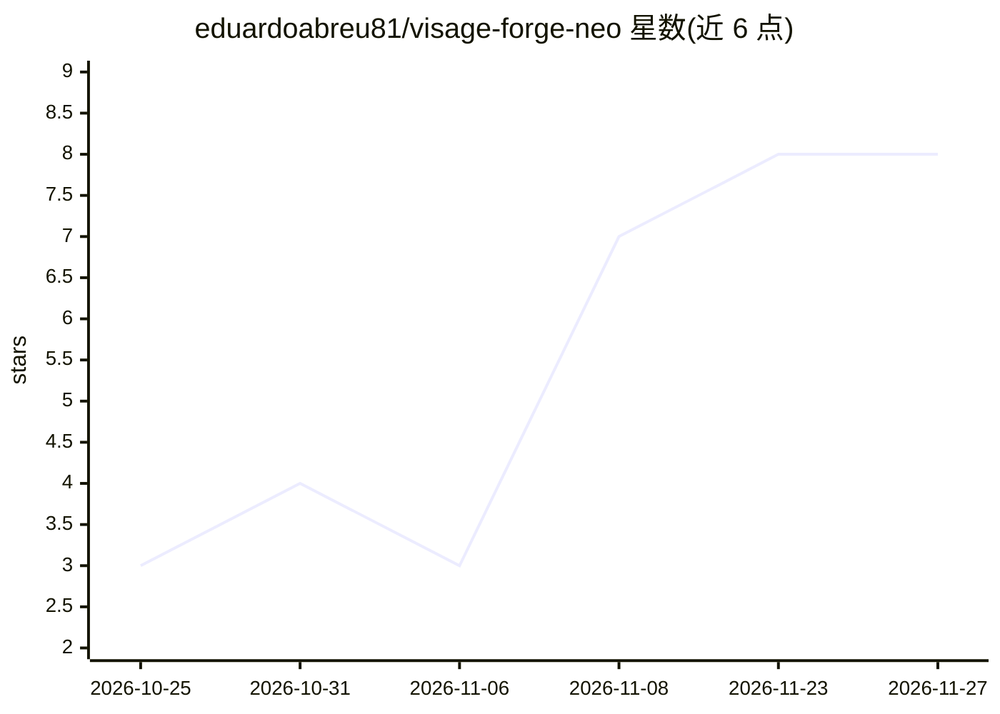

# eduardoabreu81/visage-forge-neo

⭐ 8 · Python · AGPL-3.0 · 推送 2026-11-19 · [GitHub](https://github.com/eduardoabreu81/visage-forge-neo) · 个人维护

**Forge Neo 的换脸/修脸/精修扩展，纯 ONNX 无需编译**

面向 Stable Diffusion WebUI Forge - Neo 的扩展，在 txt2img、img2img 与 Extras 标签页内完成换脸、人脸修复与基于 checkpoint 的精修。管道仅由 onnxruntime + numpy + opencv 组成，不安装 insightface，也不改动 Forge 的 Python 环境；模型首次使用时从上游下载并校验 SHA-256。默认 CPU 运行，可在设置中切换 NVIDIA（CUDA）、DirectML 或 CoreML。支持 14 种换脸模型、XSeg 遮挡遮罩、BiSeNet 面部区域选择、多种修复器与 REST API。README 标注当前为 Preview，已在 Forge Neo 2.30 上测试。

## 筛选速览

| 维度 | 判定 | 备注 |
|---|---|---|
| AI 角色 | `ai-native` | 本体是模型或模型工具 |
| 许可风险 | `dual` | AGPL-3.0 |
| 部署形态 | `None` |  |
| 模型依赖 | — | README 未给出锁定关系 |
| 硬件要求 | — | 无带数字的原话,不猜 |
| 安装摩擦 | `medium` | 含编译或系统依赖之一 |
| 成熟度 | `idea` | |

## 能力要点

- 14 种 ONNX 换脸模型（HyperSwap、inswapper、GHOST、SimSwap、HiFiFace 等）与像素增强分块推理
- GFPGAN/CodeFormer/GPEN-BFR/RestoreFormer++ 修复，带 likeness guard 相似度保护
- XSeg 遮挡遮罩、BiSeNet 面部区域选择、肤色匹配与 SFW 过滤器（默认关闭）
- Extras 面板、PNG Info 回填、X/Y/Z 绘图与 /visage/v1/ REST API

## 适用场景

- 在 Forge Neo 生图流程中把生成人物换成指定来源人脸
- 对人像特写做修复与 checkpoint 低降噪精修以保留皮肤纹理
- 多人图中按索引指定要替换的目标人脸
- 通过 Extras 标签或 REST API 对已有图片批量换脸/修脸

## 场景标签

`图像生成` · 领域:内容生成

## 证据(README 行号)

> L11: > **Extension for Stable Diffusion WebUI Forge - Neo**
> L13: Swap, restore and refine faces inside Forge Neo. Visage works in txt2img, img2img and the Extras tab, using the Gen
> L87: - **14 swap models**: HyperSwap 1A/1B/1C, AlphaFace, inswapper (+fp16), ReSwapper 128/256, GHOST 1/2/3, SimSwap 256

## 星数曲线

2026-10-25 3 → 2026-11-27 8（+5）

---
*卡片 v1 · prompt 1.4 · 生成 2026-11-20 · 置信度 high · 依据 README sha `0d49123a0f0a` · [字段定义](../../DATASET.md)*
