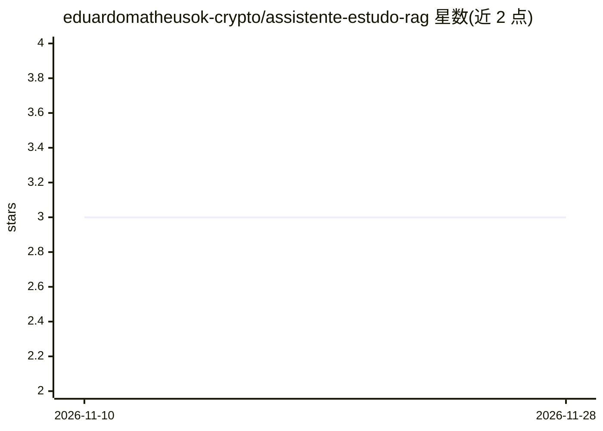

# eduardomatheusok-crypto/assistente-estudo-rag

⭐ 3 · TypeScript · MIT · 推送 2026-11-08 · [GitHub](https://github.com/eduardomatheusok-crypto/assistente-estudo-rag) · 个人维护

**基于自有资料回答的 RAG 备考助手，带页码引用与模拟面试**

面向准备技术面试的编程初学者：上传讲义/笔记（PDF/MD/TXT）后提问，回答仅来自用户资料并附文档与页码引用，点击可定位到 PDF 原文片段；划重点须逐字存在于原文，否则丢弃。支持闪卡（间隔重复）、多选题模拟考试与按 Free/Guided/STAR 格式的模拟面试，面试评分由代码计算（内容 60%+形式 40%）。检索采用关键词+语义混合搜索与 RRF 融合；Gemini 输出经 Zod schema 校验。Docker 一键运行于 Gemini 免费层，接口无登录，默认仅监听本机；不支持纯扫描版 PDF，界面与提示词为巴西葡萄牙语。

## 筛选速览

| 维度 | 判定 | 备注 |
|---|---|---|
| AI 角色 | `ai-native` | 本体是模型或模型工具 |
| 许可风险 | `permissive` | MIT |
| 部署形态 | `self-host` | docker 或自建部署 |
| 模型依赖 | — | README 未给出锁定关系 |
| 硬件要求 | — | 无带数字的原话,不猜 |
| 安装摩擦 | `low` | 无编译、无系统依赖或容器化 |
| 成熟度 | — | 结构信号不足 |

## 能力要点

- 每条回答附 [文档,页码] 引用，一键定位 PDF 原文片段
- 引用/划重点/闪卡须逐字对应原文，由代码校验而非 AI
- 混合检索（关键词+语义）经 Reciprocal Rank Fusion 合并
- 面试评分由代码计算：60% 内容 + 40% 形式

## 适用场景

- 用自己上传的讲义和笔记备考技术面试
- 对学习材料做逐字可核验的划重点
- 通过闪卡与模拟面试练习口头作答

## 场景标签

`RAG` `文档问答` · 领域:知识与检索

## 证据(README 行号)

> L30: > **Built for people who are starting out in programming and preparing for job interviews.** Add your material (han
> L153: **RAG** (*Retrieval-Augmented Generation*) means that, before the AI answers, the system **retrieves** the right p
> L166: - **Interview score computed by code:** the AI, acting as a demanding senior interviewer, only classifies the answ

## 星数曲线

2026-11-10 3 → 2026-11-28 3（+0）

---
*卡片 v1 · prompt 1.4 · 生成 2026-11-22 · 置信度 high · 依据 README sha `bae920b3cb28` · [字段定义](../../DATASET.md)*
