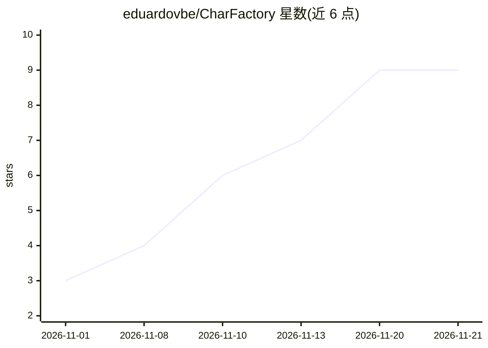

# eduardovbe/CharFactory

⭐ 9 · Python · MIT · 推送 2026-11-18 · [GitHub](https://github.com/eduardovbe/CharFactory) · 个人维护

**面向 MUGEN/Ikemen GO 角色作者的 AI 辅助角色编辑器**

一个开源的 M.U.G.E.N 与 Ikemen GO 角色编辑器，覆盖精灵、动画、Clsn 碰撞框、声音与 CNS/CMD/AIR/DEF 代码编辑，内置逐帧状态模拟器与备份对比。AI 部分：内置侧栏助手可用 Anthropic/OpenAI/Gemini API key 或 Ollama/LM Studio 本地模型对话修改角色；同时提供 MCP 服务器（35 个工具，如 get_move/edit_state/simulate_state），让 Claude Code、Codex、Cursor 等客户端连接并直接编辑打开的角色。修改即时显示、可撤销，保存前不写盘。提供 Windows/macOS/Linux 免安装包与命令行工具。

## 筛选速览

| 维度 | 判定 | 备注 |
|---|---|---|
| AI 角色 | `ai-enhanced` | 去掉 AI 部分产品仍成立 |
| 许可风险 | `permissive` | MIT |
| 部署形态 | `desktop` | 安装包/桌面程序 |
| 模型依赖 | local-ok | 支持本地模型 |
| 硬件要求 | — | 无带数字的原话,不猜 |
| 安装摩擦 | `low` | 无编译、无系统依赖或容器化 |
| 成熟度 | — | 结构信号不足 |

## 能力要点

- 内置 AI 助手与 MCP 服务器（35 个工具），代理可读取动画选姿势、写状态代码、拟合碰撞框并模拟验证
- 逐帧状态模拟器输出 startup/active/recovery 帧数据，支持备份版本并排对比
- 时间线拖拽自动重写触发器；一键生成解剖式 Clsn2 与攻击 Clsn1
- 支持 SFF/AIR/CMD/CNS/ZSS 等格式读写，多角色标签页、自动备份与 CLI（render/sim/convert-sff/mcp）

## 适用场景

- 用自然语言让 AI 代理在打开的角色中新建招式并模拟验证命中
- 逐帧调试招式帧数据并与备份版本对比优劣
- 编辑/生成调色板、切片精灵图、移植其他角色的招式
- 在脚本或 CI 中用命令行校验、渲染动画、转换 SFF

## 场景标签

`代码生成` · 领域:编码与开发

## 证据(README 行号)

> L9:  A free, open source editor for M.U.G.E.N and Ikemen GO characters. Inspired by Fighter Factory.
> L45: Ask for a move in plain words and an AI agent builds it in the open character: it reads the states,
> L56:  Your own agent through MCP

## 星数曲线

2026-11-01 3 → 2026-11-21 9（+6）

---
*卡片 v1 · prompt 1.4 · 生成 2026-11-20 · 置信度 mid · 依据 README sha `b327270f3606` · [字段定义](../../DATASET.md)*
