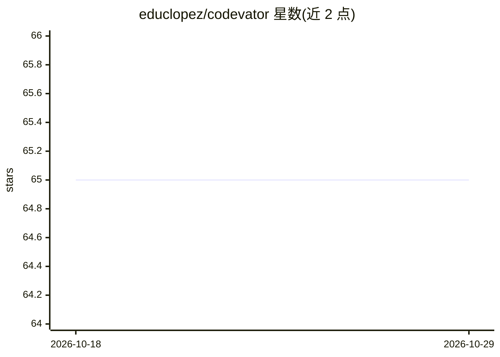

# educlopez/codevator

⭐ 65 · TypeScript · MIT · 推送 2026-10-22 · [GitHub](https://github.com/educlopez/codevator) · [官网](https://codevator.dev) · 个人维护

**AI 编码 agent 工作时自动播放背景音乐的 CLI 工具**

通过安装 agent hooks 在编码代理开始工作时自动播放背景音、停止时静音的命令行工具。支持 claude（默认）、codex、gemini、copilot、cursor、windsurf、opencode 等 7 种 agent，内置 15 种声音（lofi/自然音/音乐等 3 类），支持 Spotify 集成与自定义音频导入。另提供 agent skill 包让代理直接控制音效切换、音量与播放。附带配置预设、macOS 菜单栏应用与诊断命令，通过 npx 安装。

## 筛选速览

| 维度 | 判定 | 备注 |
|---|---|---|
| AI 角色 | `ai-enhanced` | 去掉 AI 部分产品仍成立 |
| 许可风险 | `permissive` | MIT |
| 部署形态 | `library` | 以包/库形式分发 |
| 模型依赖 | — | README 未给出锁定关系 |
| 硬件要求 | — | 无带数字的原话,不猜 |
| 安装摩擦 | `low` | 无编译、无系统依赖或容器化 |
| 成熟度 | — | 结构信号不足 |

## 能力要点

- agent 开始工作自动播放、停止自动静音的 hook 机制
- 支持 claude/codex/gemini/copilot/cursor/windsurf/opencode 7 种 agent
- 15 种内置声音 + Spotify 集成 + 自定义音频导入
- agent skill 让代理直接控制音效、音量与播放

## 适用场景

- 让 Claude Code 等编码代理工作时播放背景音乐
- 通过对话让代理切歌或调音量
- 保存音效与音量预设按场景切换

## 场景标签

 · 领域:开发者工具/音频

## 证据(README 行号)

> L6: Background music for your AI coding agent.
> L28: Supported agents: `claude` (default), `codex`, `gemini`, `copilot`, `cursor`, `windsurf`, `opencode`

## 星数曲线

2026-10-18 65 → 2026-10-29 65（+0）

---
*卡片 v1 · prompt 1.4 · 生成 2026-10-24 · 置信度 high · 依据 README sha `69f301bc9b31` · [字段定义](../../DATASET.md)*
