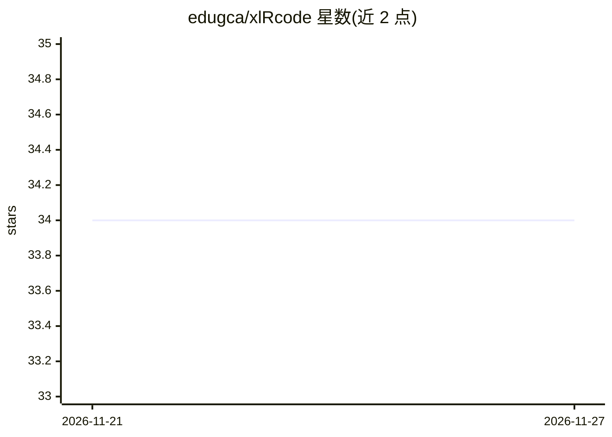

# edugca/xlRcode

⭐ 34 · R · MIT · 推送 2026-11-20 · [GitHub](https://github.com/edugca/xlRcode) · 个人维护

**让 Excel 用户在表格中调用 R 代码与包的加载项**

一个 Excel 加载项（.xll，基于 ExcelDna），在 Windows Excel 中新增 7 个工作表函数（XLRCODE/XLRSCRIPT/XLRFUNC 及其 _ENV 变体、XLRDATE），可在单元格中运行 R 代码、R 脚本或调用 R 函数，并在 Excel 与 R 之间双向传递值；支持本地或指定环境中执行、异步运行、R 包管理界面与控制台。要求本机已安装 R，仅支持 Windows，已在 Excel 365 64 位和 R 4.0.2 上测试。文档以随附的 xlsx 电子表格形式提供。

## 筛选速览

| 维度 | 判定 | 备注 |
|---|---|---|
| AI 角色 | `ai-enhanced` | 去掉 AI 部分产品仍成立 |
| 许可风险 | `permissive` | MIT |
| 部署形态 | `None` |  |
| 模型依赖 | — | README 未给出锁定关系 |
| 硬件要求 | — | 无带数字的原话,不猜 |
| 安装摩擦 | `low` | 无编译、无系统依赖或容器化 |
| 成熟度 | `idea` | |

## 能力要点

- 7 个新 Excel 函数，可运行 R 代码/脚本/函数并双向传值
- 全部 XLRCODE 函数异步执行，独立线程（4Mb 栈）避免栈溢出
- 内置 R 控制台、包安装/更新管理与图片刷新按钮
- 区分 NA/NAN/NULL 并映射为对应 Excel 错误值

## 适用场景

- 在 Excel 单元格中直接调用 R 统计函数做数据分析
- 用 Excel 公式串联已有的 R 脚本流程
- 在电子表格中使用 R 生态的机器学习与计量经济学包

## 场景标签

`数据分析` · 领域:效率与自动化

## 证据(README 行号)

> L3: Call R from Excel. Create new Excel functions that make use of R packages. Integrate both tools seamlessly.
> L18:  - Run R code in a local environment and transfer values from and to Excel. Function memory is cleared after calcul

## 星数曲线

2026-11-21 34 → 2026-11-27 34（+0）

---
*卡片 v1 · prompt 1.4 · 生成 2026-11-21 · 置信度 high · 依据 README sha `74520b26ae9b` · [字段定义](../../DATASET.md)*
