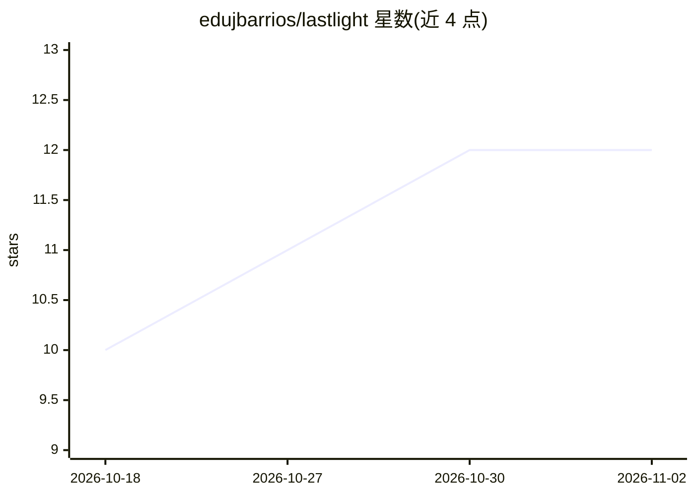

# edujbarrios/lastlight

⭐ 12 · Python · NOASSERTION · 推送 2026-10-23 · [GitHub](https://github.com/edujbarrios/lastlight) · 个人维护

**灾难场景离线知识检索库：纯标准库、低功耗、可溯源回答**

面向灾害与基础设施失效场景的 Python 检索库：从本地 Markdown/ZIP 知识包中检索实用知识，返回答案文本、来源段落与置信度，证据不足时以结构化拒绝码拒答。仅依赖 Python 标准库，无云 API、无嵌入、无向量库；提供 lexical/BM25/RRF 混合与自适应策略，按资源策略（如能耗预算）选择检索方案。大文档按标题与 1,800 字符段落感知分块。知识包采用带清单校验的 v1 版本化格式。答案为检索所得而非生成，Python API 为主，附 CLI。

## 筛选速览

| 维度 | 判定 | 备注 |
|---|---|---|
| AI 角色 | `ai-native` | 本体是模型或模型工具 |
| 许可风险 | `none` | NOASSERTION |
| 部署形态 | `library` | 以包/库形式分发 |
| 模型依赖 | — | README 未给出锁定关系 |
| 硬件要求 | — | 无带数字的原话,不猜 |
| 安装摩擦 | `low` | 无编译、无系统依赖或容器化 |
| 成熟度 | — | 结构信号不足 |

## 能力要点

- 纯标准库实现，无云 API/嵌入/向量库/遥测
- lexical、BM25、RRF 混合与自适应策略，可按能耗预算调整
- 置信度感知拒答与结构化拒绝码，答案附可检视来源路径
- 知识包 v1 版本化清单校验，拒绝不安全 ZIP 路径并支持 SHA-256 指纹

## 适用场景

- 断网断电等基础设施不可靠场景下离线查询应急知识
- 为应急知识包（食品安全/饮水净化等）构建可审计的本地问答
- 在低功耗设备上按资源策略控制检索成本

## 场景标签

`文档问答` · 领域:知识与检索

## 证据(README 行号)

> L11: LastLight retrieves practical knowledge from local Markdown/ZIP packs, exposes source passages and ranking metadata
> L13: No cloud API. No embeddings. No vector database. No telemetry. No runtime dependencies outside the Python standard 
> L57: The interaction is intentionally assistant-like, but the answer is **retrieved from local knowledge, not generated*

## 星数曲线

2026-10-18 10 → 2026-11-02 12（+2）

---
*卡片 v1 · prompt 1.4 · 生成 2026-11-01 · 置信度 high · 依据 README sha `674d48b08661` · [字段定义](../../DATASET.md)*
