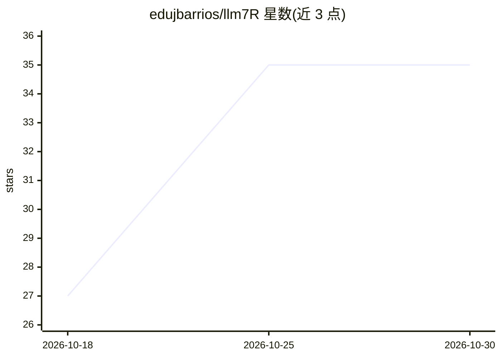

# edujbarrios/llm7R

⭐ 35 · R · GPL-2.0 · 推送 2026-10-06 · [GitHub](https://github.com/edujbarrios/llm7R) · [官网](https://llm7.io/) · 个人维护

**在 R 中调用 LLM7.io API 的轻量客户端**

面向 R 用户的 LLM7.io API 第三方客户端（非 LLM7.io 官方维护）：提供聊天补全、实时模型目录查询与按能力筛选（JSON/视觉/工具调用/流式/图像/视频）、SSE 流式输出、JSON 结构化输出、函数/工具调用、数据框分析（analyze_dataframe 自动构建列与摘要统计的提示词）、图像识别与图像生成/编辑、异步视频生成。安装方式为 git clone 后 source("llm7.R") 加载，依赖 httr/jsonlite/base64enc/curl，尚未打包为 CRAN 包；视觉工作流要求公开可达的 HTTPS 图片 URL，data-URI 仅为兼容选项。

## 筛选速览

| 维度 | 判定 | 备注 |
|---|---|---|
| AI 角色 | `ai-ecosystem` | LLM/agent 周边工具 |
| 许可风险 | `viral` | GPL-2.0 |
| 部署形态 | `None` |  |
| 模型依赖 | — | README 未给出锁定关系 |
| 硬件要求 | — | 无带数字的原话,不猜 |
| 安装摩擦 | `low` | 无编译、无系统依赖或容器化 |
| 成熟度 | — | 结构信号不足 |

## 能力要点

- 聊天补全、SSE 流式、JSON 模式与工具调用
- 实时模型目录查询与按能力筛选（find_models）
- 数据框分析：自动构建含摘要统计与样本行的提示词
- 图像识别、图像生成/编辑与异步视频生成

## 适用场景

- 在 R 数据分析流程中直接向 LLM 提问
- 用自然语言分析 mtcars/iris 等数据框并生成分析计划
- 在 R 中获取结构化 JSON 输出或调用函数工具
- 在 R 工作流中生成或编辑图像、生成视频

## 场景标签

`数据分析` `图像生成` `视频生成` · 领域:效率与自动化

## 证据(README 行号)

> L3: **llm7R v2.0.0** is a lightweight R client for the current LLM7.io API.
> L5: It supports chat completions, live model discovery, streaming, JSON mode, tool calling, data-frame analysis, vision,

## 星数曲线

2026-10-18 27 → 2026-10-30 35（+8）

---
*卡片 v1 · prompt 1.4 · 生成 2026-10-25 · 置信度 high · 依据 README sha `8940af31b400` · [字段定义](../../DATASET.md)*
