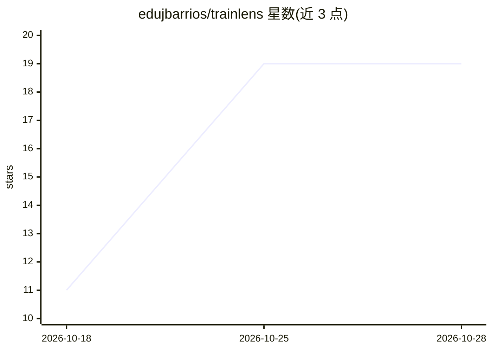

# edujbarrios/trainlens

⭐ 19 · Python · NOASSERTION · 推送 2026-10-28 · [GitHub](https://github.com/edujbarrios/trainlens) · 个人维护

**分析 ML 训练运行并产出本地确定性证据与报告的 Python 库**

面向在 Python/Jupyter 中进行模型训练的开发者：读取 notebook 变量或保存的 run JSON，规范化指标、区分训练/验证/测试集，生成确定性的发现、报告与曲线图，不训练模型、不需要追踪服务器。提供三种模式：本地确定性分析、Agent Mode（为外部编码/研究 agent 准备带 ID 的证据并校验其引用）、以及可选的直接 LLM 报告（OpenAI 兼容端点）。附带 CLI 可比较实验与检查回归。Apache-2.0 许可。

## 筛选速览

| 维度 | 判定 | 备注 |
|---|---|---|
| AI 角色 | `ai-ecosystem` | LLM/agent 周边工具 |
| 许可风险 | `none` | NOASSERTION |
| 部署形态 | `library` | 以包/库形式分发 |
| 模型依赖 | — | README 未给出锁定关系 |
| 硬件要求 | — | 无带数字的原话,不猜 |
| 安装摩擦 | `low` | 无编译、无系统依赖或容器化 |
| 成熟度 | — | 结构信号不足 |

## 能力要点

- 从 notebook 变量或 run JSON 生成本地确定性训练分析
- Agent Mode 为外部 agent（Codex/Claude/Cursor）准备带 ID 证据并校验引用
- 可选直连 OpenAI 兼容端点生成 LLM 报告
- CLI 比较实验与回归检查，无需服务器

## 适用场景

- 训练后排查指标异常，弄清哪里出了问题
- 为编码/研究 agent 提供可引用的训练证据
- 比较两次实验并按阈值（如 f1>=0.85）检查回归

## 场景标签

`模型评测` `MLOps` · 领域:评测与运维

## 证据(README 行号)

> L5: TrainLens analyzes metrics and training state from Python/Jupyter notebooks or saved runs. It produces local, determ
> L39: 3. **Use the results:** read a report, plot curves, compare runs, or optionally send bounded evidence to an agent o

## 星数曲线

2026-10-18 11 → 2026-10-28 19（+8）

---
*卡片 v1 · prompt 1.4 · 生成 2026-10-28 · 置信度 high · 依据 README sha `d0718d94285f` · [字段定义](../../DATASET.md)*
