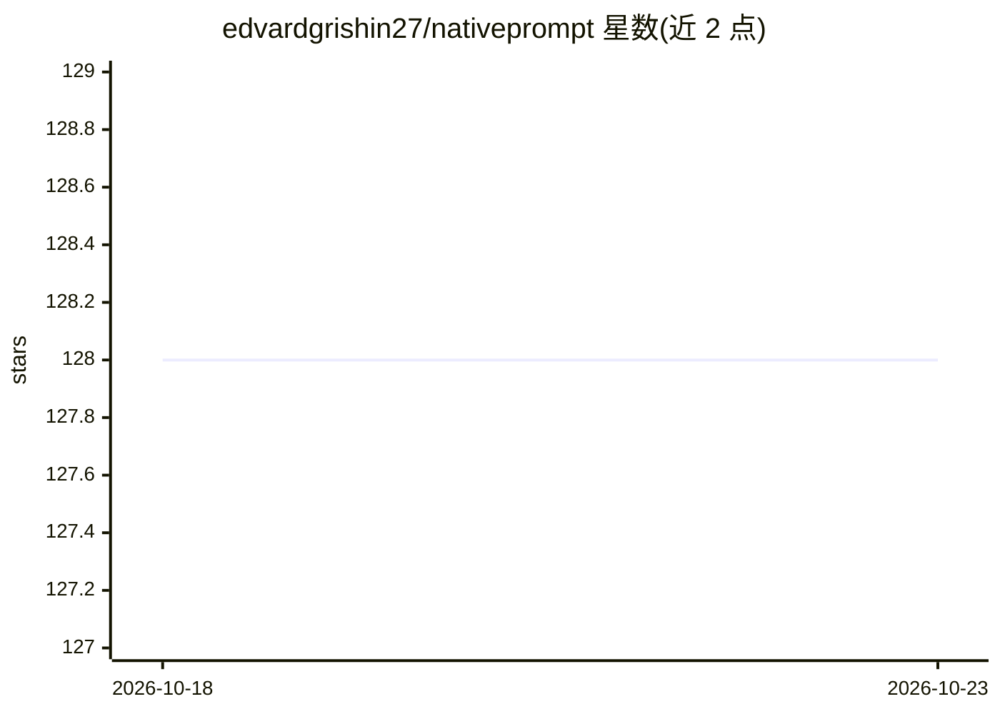

# edvardgrishin27/nativeprompt

⭐ 128 · Python · MIT · 推送 2026-10-19 · [GitHub](https://github.com/edvardgrishin27/nativeprompt) · [官网](https://pypi.org/project/nativeprompt/) · 个人维护

**离线提示词改写 CLI：按当前模型的官方规则重写并建议努力级别**

面向同时使用 Claude Code 与 Codex 的开发者的 Python 命令行工具：自动检测当前会话所用模型（--model、CLI 标记、环境变量、配置文件级联），按各厂商官方文档规则（Claude 18 条、OpenAI 8 条）本地检查并改写提示词，每条修改附官方文档链接，并建议以何种努力级别（/effort、model_reasoning_effort）运行任务。内部无模型，仅用正则加版本化规则表，离线工作、零依赖、无需 API 密钥；update 命令联网核对厂商文档是否变更。支持 Gemini CLI、Grok Build、Qwen Code、Kimi CLI 各一条规则。

## 筛选速览

| 维度 | 判定 | 备注 |
|---|---|---|
| AI 角色 | `ai-ecosystem` | LLM/agent 周边工具 |
| 许可风险 | `permissive` | MIT |
| 部署形态 | `library` | 以包/库形式分发 |
| 模型依赖 | — | README 未给出锁定关系 |
| 硬件要求 | — | 无带数字的原话,不猜 |
| 安装摩擦 | `low` | 无编译、无系统依赖或容器化 |
| 成熟度 | — | 结构信号不足 |

## 能力要点

- 按家族+代际自动检测当前模型并应用对应官方规则
- 每条修改附官方文档链接，update 跟踪 25 页文档新鲜度
- 零运行时依赖、离线可用、无 API 密钥（仅 update 需联网）
- 输出含可复现性卡片（规则版本、模型代际、提示词 sha256 前缀）

## 适用场景

- 同一提示词在 Claude Code 和 Codex 两窗口间适配不同模型语法
- 按厂商官方建议选择任务的运行命令与努力级别
- 团队以 JSON 规则表经 PR 维护统一提示词规范

## 场景标签

`提示工程` · 领域:Agent 开发

## 证据(README 行号)

> L128: Разбор считается локально: регулярные выражения плюс версионированная шпаргалка правил. Ни
> L175: Область применения это **агентные CLI**: Claude Code, Codex, а также Gemini CLI, Grok Build,

## 星数曲线

2026-10-18 128 → 2026-10-23 128（+0）

---
*卡片 v1 · prompt 1.4 · 生成 2026-10-23 · 置信度 high · 依据 README sha `1ec4daeef822` · [字段定义](../../DATASET.md)*
