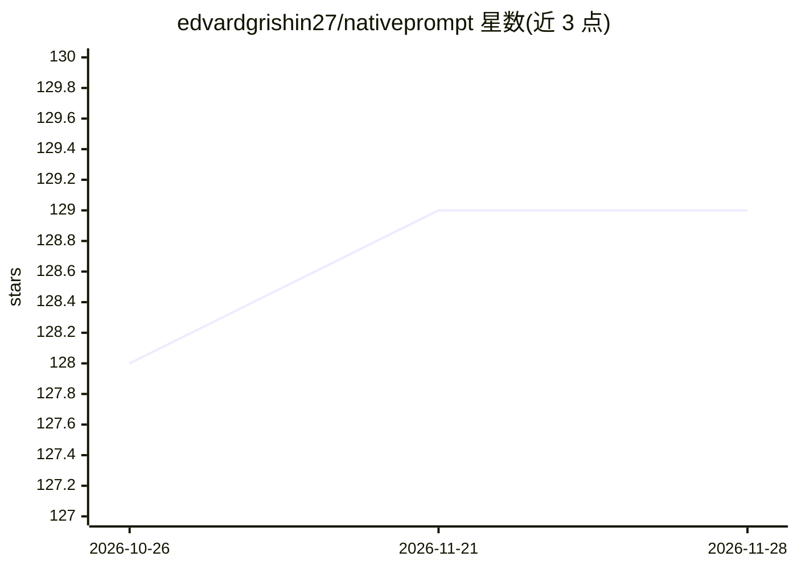

# edvardgrishin27/nativeprompt

⭐ 129 · Python · MIT · 推送 2026-11-23 · [GitHub](https://github.com/edvardgrishin27/nativeprompt) · [官网](https://pypi.org/project/nativeprompt/) · 个人维护

**按各模型官方规则检查并改写提示词的离线 CLI 工具**

面向使用 Claude Code、Codex 等代理 CLI 的开发者：按目标模型的官方提示词规则检查/改写提示词与 CLAUDE.md、AGENTS.md 等指令文件，每条修改附厂商文档链接，并建议 effort 级别。自动检测当前模型（--model、会话标记、环境变量、配置文件级联）。解析完全本地化（正则+版本化规则表），零运行时依赖、无 API key、可离线运行；文学性改写交给用户已订阅的模型执行。规则按模型代际组织，团队可经 PR 维护 JSON 规则表。

## 筛选速览

| 维度 | 判定 | 备注 |
|---|---|---|
| AI 角色 | `ai-native` | 本体是模型或模型工具 |
| 许可风险 | `permissive` | MIT |
| 部署形态 | `library` | 以包/库形式分发 |
| 模型依赖 | locked-api |  |
| 硬件要求 | — | 无带数字的原话,不猜 |
| 安装摩擦 | `low` | 无编译、无系统依赖或容器化 |
| 成熟度 | — | 结构信号不足 |

## 能力要点

- 按模型代际区分规则：Claude Fable/Opus/Sonnet/Haiku、GPT-6 系列各有专属规则表
- 每条建议附官方厂商文档链接，update 命令跟踪 25 页文档的新鲜度
- 零外部依赖、无 API key、离线可用，改写走用户已有订阅的模型
- audit 命令检查指令文件中过时写法并输出 file:line:rule 格式

## 适用场景

- 同时使用 Claude Code 与 Codex 时让同一提示词适配不同模型
- 检查项目里 CLAUDE.md/AGENTS.md 中针对旧模型写法的提示语句
- 不想为提示词优化付第二份 API 账单
- 教学中引用官方文档出处讲解提示词规则

## 场景标签

`提示工程` · 领域:Agent 开发

## 证据(README 行号)

> L7: **Один и тот же промпт Claude Code и Codex читают по-разному. nativeprompt переписывает его
> L145: Разбор считается локально: регулярные выражения плюс версионированная шпаргалка правил. Ни
> L192: Область применения это **агентные CLI**: Claude Code, Codex, а также Gemini CLI, Grok Build,

## 星数曲线

2026-10-26 128 → 2026-11-28 129（+1）

---
*卡片 v1 · prompt 1.4 · 生成 2026-11-28 · 置信度 high · 依据 README sha `54cbad27a9f7` · [字段定义](../../DATASET.md)*
