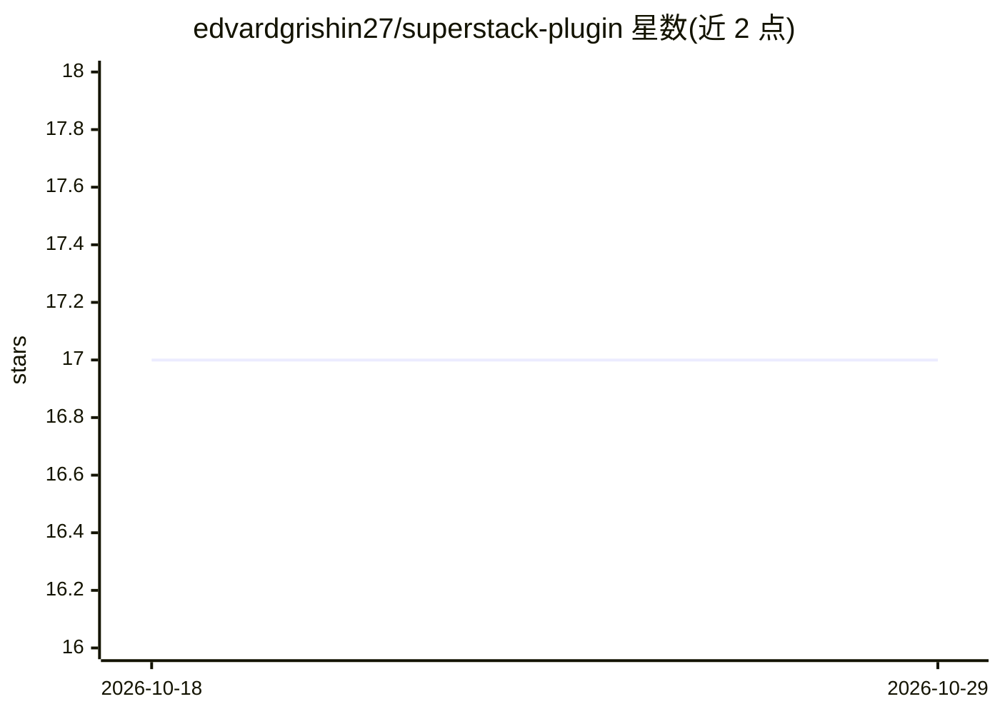

# edvardgrishin27/superstack-plugin

⭐ 17 · Python · MIT · 推送 2026-09-09 · [GitHub](https://github.com/edvardgrishin27/superstack-plugin) · 个人维护

**Claude Code 插件：从一句需求到经机器验证的可用版本**

SUPERSTACK 是面向 Claude Code 的插件，用户用自然语言描述想构建的产品，系统生成需求清单、规格、界面设计、由用户确认的计划，再交由执行代理逐步实现。核心机制：`hooks/verify-gate.py` 以项目命令的返回码决定任务是否关闭；`agents/blind-acceptance.md` 盲验收代理仅依据原始请求与变更判断是否完成；`tools/checkpoint.py` 提供阶段快照与一句话回滚；文件刹车可在代理无响应时暂停。仅依赖 Python 3 标准库（72 个工具约 24800 行），通过 Claude Code 插件市场命令安装，带俄/英双语 README。

## 筛选速览

| 维度 | 判定 | 备注 |
|---|---|---|
| AI 角色 | `ai-ecosystem` | LLM/agent 周边工具 |
| 许可风险 | `permissive` | MIT |
| 部署形态 | `None` |  |
| 模型依赖 | locked-api |  |
| 硬件要求 | — | 无带数字的原话,不猜 |
| 安装摩擦 | `low` | 无编译、无系统依赖或容器化 |
| 成熟度 | — | 结构信号不足 |

## 能力要点

- 返回码验证门：检查非零则任务不关闭
- 盲验收代理只依据原始请求与变更做判定
- 阶段快照与 /oops 一句话回滚，删除进隔离区不直接删
- 仅用 Python 3 标准库，零第三方依赖，2447 测试与 702 个注册变异

## 适用场景

- 用一句话描述产品并让其驱动 Claude Code 完成从需求到验证的实现
- 对已构建功能做小修改并自动快照、验证与回滚
- 检查插件自身安装与运行状态

## 场景标签

`编码 Agent` · 领域:编码与开发

## 证据(README 行号)

> L15: плагин Claude Code
> L21: SUPERSTACK — плагин для Claude Code. Ты описываешь продукт своими словами —

## 星数曲线

2026-10-18 17 → 2026-10-29 17（+0）

---
*卡片 v1 · prompt 1.4 · 生成 2026-10-29 · 置信度 high · 依据 README sha `1a6b9d135c81` · [字段定义](../../DATASET.md)*
