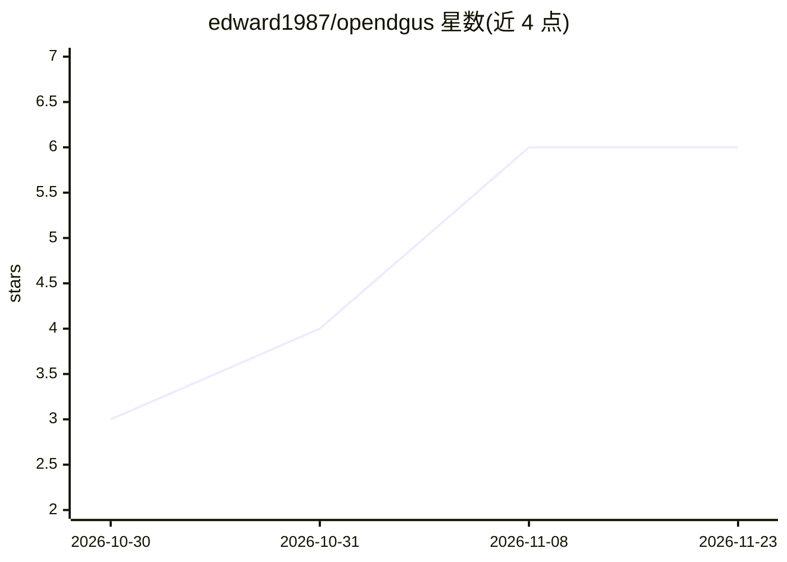

# edward1987/opendgus

⭐ 6 · Python · GPL-3.0 · 推送 2026-11-01 · [GitHub](https://github.com/edward1987/opendgus) · 个人维护

**为 DWIN T5L 触摸屏提供开源设计器与 AI 设计功能**

面向 DWIN T5L (DGUS II) 触摸显示器的开源设计工具，替代官方闭源 Windows 工具的完整工作流：可视化拖拽编辑（47 种 DGUS II 控件、22 个响应式模板）、桌面模拟器预览与 UART 帧查看、一键经 USB/UART 下载或导出 microSD。内置 AI 设计器：自然语言描述生成界面，AI 通过编辑器工具链修改项目并自我修正，支持多提供商与本地运行。另提供 MCP server、控制器代码生成（Arduino/MicroPython/Python）及 DGUS 旧项目导入。安装包未代码签名。

## 筛选速览

| 维度 | 判定 | 备注 |
|---|---|---|
| AI 角色 | `ai-enhanced` | 去掉 AI 部分产品仍成立 |
| 许可风险 | `viral` | GPL-3.0 |
| 部署形态 | `desktop` | 安装包/桌面程序 |
| 模型依赖 | local-ok | 支持本地模型 |
| 硬件要求 | — | 无带数字的原话,不猜 |
| 安装摩擦 | `low` | 无编译、无系统依赖或容器化 |
| 成熟度 | — | 结构信号不足 |

## 能力要点

- AI 设计器：描述界面需求，AI 生成并可自我修正，改动可用 Ctrl+Z 撤销
- 全部 47 种 DGUS II 原生控件，字节级对照官方编辑器代码校验
- 桌面模拟器可模拟 MCU 变量并查看 UART 帧日志
- 提供 MCP server，可从 Claude Desktop 等 MCP 客户端调用

## 适用场景

- 为 DWIN T5L 屏幕可视化设计 HMI 界面并烧录
- 用自然语言让 AI 生成或修改显示界面
- 没有下载线时用 microSD 卡刷入 DWIN_SET 文件夹
- 为控制器生成 Arduino/MicroPython/Python 通信程序

## 场景标签

`代码生成` · 领域:编码与开发

## 证据(README 行号)

> L5: **The open-source designer for DWIN T5L (DGUS II) touch displays, with an AI designer built in.**
> L29: |✨ **AI designer**|Describe the screen and the AI builds it, sees its own renders, and fixes what looks wrong. Work

## 星数曲线

2026-10-30 3 → 2026-11-23 6（+3）

---
*卡片 v1 · prompt 1.4 · 生成 2026-11-20 · 置信度 high · 依据 README sha `9f607539f6d6` · [字段定义](../../DATASET.md)*
