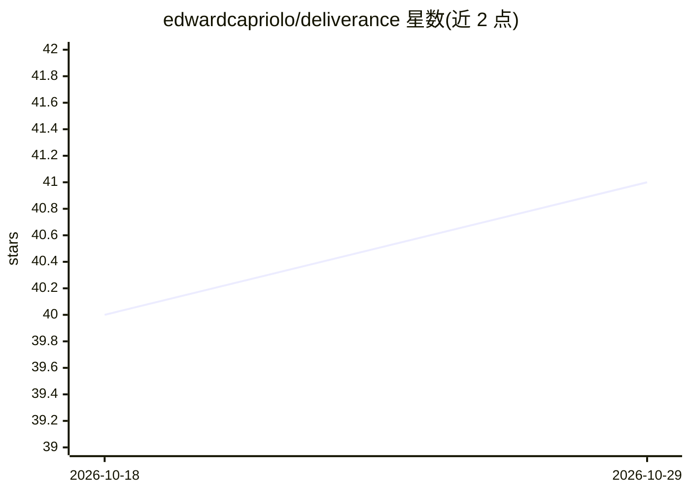

# edwardcapriolo/deliverance

⭐ 41 · Java · Apache-2.0 · 推送 2026-10-28 · [GitHub](https://github.com/edwardcapriolo/deliverance) · 个人维护

**Java 编写的 LLM 推理引擎，本地运行生成/嵌入/分类**

基于 Java（Project Panama、JNI、SIMD、JQ4 量化）的 LLM 推理引擎：支持生成、嵌入、文本分类等推理类型，可嵌入应用或以 HTTP 服务（OpenAI 风格 chat/completions）运行。支持 gemma2、llama、qwen3、mixtral、Nemotron Labs Diffusion 等模型，提供 safetensors 加载、内存映射张量、张量并行、KVCache2、LoRA 适配器（实现中）、引导式生成与前缀缓存。分发为 Docker 镜像或源码构建，编译产物为 <50MB 启动应用。HTTP API 支持可能不完整（如缺模型删除端点）。

## 筛选速览

| 维度 | 判定 | 备注 |
|---|---|---|
| AI 角色 | `ai-ecosystem` | LLM/agent 周边工具 |
| 许可风险 | `permissive` | Apache-2.0 |
| 部署形态 | `self-host` | docker 或自建部署 |
| 模型依赖 | — | README 未给出锁定关系 |
| 硬件要求 | — | 无带数字的原话,不猜 |
| 安装摩擦 | `low` | 无编译、无系统依赖或容器化 |
| 成熟度 | — | 结构信号不足 |

## 能力要点

- 生成/嵌入/分类三类推理，支持 gemma2、llama、qwen3、Nemotron Labs Diffusion 等模型
- Panama 向量运算、原生 SIMD 内核、JQ4 量化与 WebGPU 输出头加速的 CPU/GPU 张量栈
- 可嵌入 Java 应用（AutoModelForCasualLm）或以 Docker HTTP 服务提供 OpenAI 风格接口
- 引导式生成（choice/regex/JSON）、前缀缓存、KVCache2 与张量并行

## 适用场景

- 在 Java/Spring 应用中嵌入本地 LLM 推理
- 替代重型推理服务，用 Docker 起一个本地 OpenAI 风格 API
- 研究 CPU 上量化模型与 diffusion 式生成的推理行为

## 场景标签

`推理引擎` · 领域:训练与推理

## 证据(README 行号)

> L3: Deliverance is a Java inference engine, capable of generating text, tokenizing input, computing embeddings, and more
> L83: Deliverance is capable of running as an API inside your application.
> L136: #### HTTP enabled inference engine (inference as a service)

## 星数曲线

2026-10-18 40 → 2026-10-29 41（+1）

---
*卡片 v1 · prompt 1.4 · 生成 2026-10-25 · 置信度 high · 依据 README sha `db9ee055c34c` · [字段定义](../../DATASET.md)*
