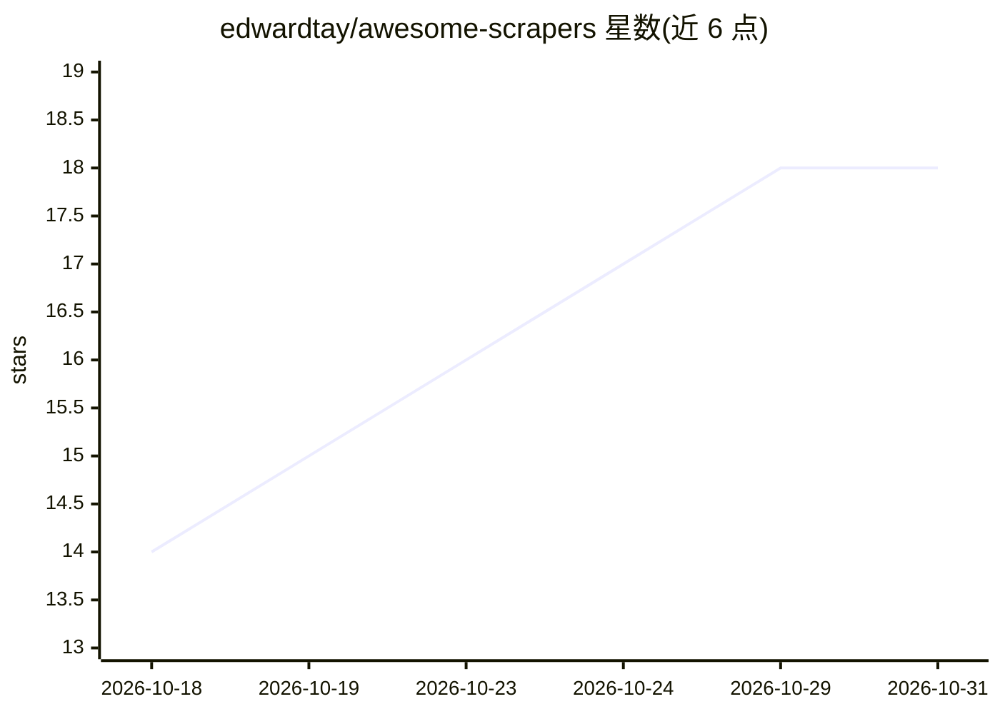

# edwardtay/awesome-scrapers

⭐ 18 · CC0-1.0 · 推送 2026-10-26 · [GitHub](https://github.com/edwardtay/awesome-scrapers) · 个人维护

**150+ 网页爬取/反检测/MCP 工具的策展清单**

按 16 个类别组织的网络爬取工具清单：AI 驱动抓取、隐身与反检测、MCP 服务器、浏览器自动化、抓取框架、HTTP 客户端、HTML/XML 解析、内容提取、社媒抓取、媒体下载、PDF 提取、OCR、区块链索引、托管 API、验证码解决与代理服务。条目含星数、语言与简介，另有弃用工具 graveyard 与维护警示标记，面向选型对比场景。

## 筛选速览

| 维度 | 判定 | 备注 |
|---|---|---|
| AI 角色 | `ai-knowledge` | 知识聚合/清单类 |
| 许可风险 | `viral` | CC0-1.0 |
| 部署形态 | `None` |  |
| 模型依赖 | — | README 未给出锁定关系 |
| 硬件要求 | — | 无带数字的原话,不猜 |
| 安装摩擦 | `low` | 无编译、无系统依赖或容器化 |
| 成熟度 | — | 结构信号不足 |

## 能力要点

- 覆盖 16 个类别的 150+ 爬取/反检测/解析工具条目
- 含 MCP 服务器专类（连接 LLM agent 与抓取工具）
- 提供 'How to Choose' 按需求导航表与弃用工具 graveyard

## 适用场景

- 按需求场景挑选合适的爬取或反检测工具
- 为 LLM agent 查找可用的网页抓取 MCP 服务器
- 了解托管抓取 API 与代理服务的选择范围

## 场景标签

`精选清单` `网页抓取` · 领域:效率与自动化

## 证据(README 行号)

> L1: Awesome Web Scrapers: crawlers, browser automation, parsers, anti-detection and MCP servers
> L11: > A curated list of scrapers, crawlers, browser automation tools, extraction libraries, and managed services.

## 星数曲线

2026-10-18 14 → 2026-10-31 18（+4）

---
*卡片 v1 · prompt 1.4 · 生成 2026-10-30 · 置信度 high · 依据 README sha `f972c192f67f` · [字段定义](../../DATASET.md)*
