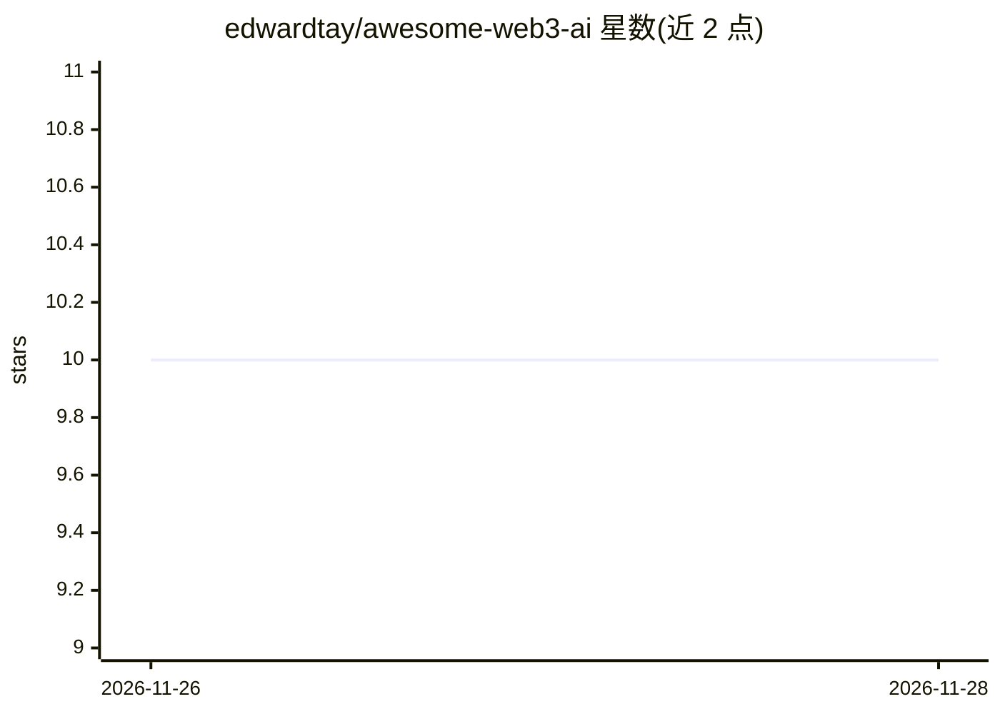

# edwardtay/awesome-web3-ai

⭐ 10 · CC0-1.0 · 推送 2026-11-23 · [GitHub](https://github.com/edwardtay/awesome-web3-ai) · 个人维护

**面向 Web3 开发者的 Web3 x AI 项目精选清单**

收录 65+ 个 Web3 与 AI 结合项目的策展清单（License: CC0），按七个类别组织：AI Agent 框架、Agent 发射台、去中心化算力、去中心化 AI 网络、数据与隐私网络、DeFi AI 工具、链上 AI 推理，另含链上基础设施与分析数据板块。每个条目给出 Stars、语言/代币、简介与仓库链接；开头提供 "How to Choose" 速查表按需求导向分类，并用 ⚠️ 标记存在维护疑虑的仓库提醒核实状态。本身不提供软件，仅聚合链接与分类信息。

## 筛选速览

| 维度 | 判定 | 备注 |
|---|---|---|
| AI 角色 | `ai-knowledge` | 知识聚合/清单类 |
| 许可风险 | `viral` | CC0-1.0 |
| 部署形态 | `None` |  |
| 模型依赖 | — | README 未给出锁定关系 |
| 硬件要求 | — | 无带数字的原话,不猜 |
| 安装摩擦 | `low` | 无编译、无系统依赖或容器化 |
| 成熟度 | — | 结构信号不足 |

## 能力要点

- 65+ 项目按 7 类组织（agent 框架、发射台、去中心化算力、链上推理等）
- How to Choose 速查表按需求映射到类别
- 条目含 Stars、语言/代币与仓库链接
- 用 ⚠️ 标记已知维护疑虑的仓库

## 适用场景

- 为链上 AI agent 开发挑选合适的框架或发射台
- 寻找去中心化 GPU 算力或链上推理协议
- 了解 Web3 x AI 生态的项目分布

## 场景标签

`精选清单` · 领域:学习与行业

## 证据(README 行号)

> L3: # Awesome Web3 AI Awesome
> L11: > A curated list of Web3 AI tools, agent frameworks, protocols, infrastructure, and data resources.

## 星数曲线

2026-11-26 10 → 2026-11-28 10（+0）

---
*卡片 v1 · prompt 1.4 · 生成 2026-11-26 · 置信度 high · 依据 README sha `5df1f2613632` · [字段定义](../../DATASET.md)*
