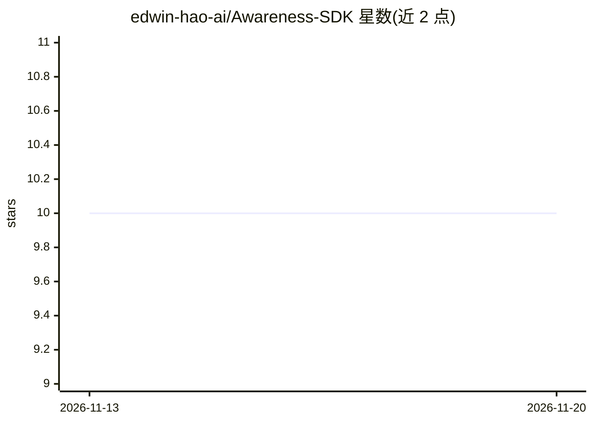

# edwin-hao-ai/Awareness-SDK

⭐ 10 · JavaScript · Apache-2.0 · 推送 2026-05-04 · [GitHub](https://github.com/edwin-hao-ai/Awareness-SDK) · [官网](https://awareness.market) · 个人维护

**给 AI agent 与编码 IDE 提供本地优先的持久记忆层**

为 AI agent 与 AI 编码工作流提供跨会话持久记忆：通过 MCP 服务器、Python/TypeScript SDK 与 IDE 插件接入，知识以 Markdown 文件存储在本地 .awareness/ 目录，支持全文与语义检索、知识卡片抽取、工作流规则注入与多 agent 协作；默认本地运行、可离线工作，云同步、向量检索与团队协作等功能为可选付费附加。零代码拦截器可包装 OpenAI/Anthropic SDK 调用，一条 npx 命令可为 13+ IDE 完成配置。

## 筛选速览

| 维度 | 判定 | 备注 |
|---|---|---|
| AI 角色 | `ai-ecosystem` | LLM/agent 周边工具 |
| 许可风险 | `permissive` | Apache-2.0 |
| 部署形态 | `library` | 以包/库形式分发 |
| 模型依赖 | — | README 未给出锁定关系 |
| 硬件要求 | — | 无带数字的原话,不猜 |
| 安装摩擦 | `low` | 无编译、无系统依赖或容器化 |
| 成熟度 | — | 结构信号不足 |

## 能力要点

- 一条 npx 命令为 Claude Code、Cursor、Windsurf 等 13+ IDE 配置记忆
- 零代码拦截器 wrap_openai/wrap_anthropic 包装现有 SDK
- 本地 Markdown 存储，默认离线可用，git 同步，云功能可选
- MCP 协议 + Python/TypeScript SDK + IDE 插件多种接入方式

## 适用场景

- 让编码 agent 记住上个会话的架构决策与待办事项
- 给已有 LLM 应用加一行代码接入持久记忆
- 多个 agent 共享记忆协同工作
- 无网络环境下本地保存与检索 agent 记忆

## 场景标签

`Agent 记忆` · 领域:Agent 开发

## 证据(README 行号)

> L14:  Local-first MCP memory platform for AI coding agents, SDK apps, and production workflows.
> L17: Awareness SDK is a local-first memory layer for AI agents and AI coding workflows. It provides persistent memory, c
> L169: - **LangChain** — Integration guide

## 星数曲线

2026-11-13 10 → 2026-11-20 10（+0）

---
*卡片 v1 · prompt 1.4 · 生成 2026-11-19 · 置信度 high · 依据 README sha `a792ac2f931f` · [字段定义](../../DATASET.md)*
