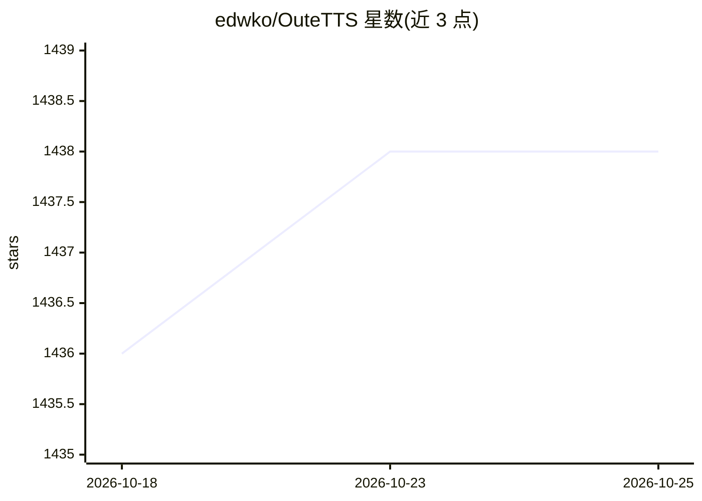

# edwko/OuteTTS

⭐ 1,438 · Python · Apache-2.0 · 推送 2026-03-23 · [GitHub](https://github.com/edwko/OuteTTS) · [官网](https://outeai.com) · 组织维护

**OuteTTS 语音合成模型的 Python 接口库，统一多后端调用**

为 OuteTTS 文本转语音模型提供统一接口：支持 llama.cpp Python 绑定、llama.cpp Server、Hugging Face Transformers 等默认后端，以及需手动安装的 ExLlamaV2、VLLM（实验性）；另有 JavaScript 的 Transformers.js 包。默认随 pip 安装 llama.cpp Python 绑定，需按硬件（CUDA/ROCm/Vulkan/Metal）指定编译参数。面向在自有应用中集成 TTS 的开发者；限制包括当前仅一个默认英文测试音色、单次生成约 42 秒音频、需特定采样配置。

## 筛选速览

| 维度 | 判定 | 备注 |
|---|---|---|
| AI 角色 | `ai-native` | 本体是模型或模型工具 |
| 许可风险 | `permissive` | Apache-2.0 |
| 部署形态 | `library` | 以包/库形式分发 |
| 模型依赖 | local-ok | 支持本地模型 |
| 硬件要求 | — | 无带数字的原话,不猜 |
| 安装摩擦 | `medium` | 含编译或系统依赖之一 |
| 成熟度 | `idea` | |

## 能力要点

- 多后端支持：llama.cpp、Transformers、ExLlamaV2、VLLM（实验性）
- 自动配置 1.0 版模型所需的采样器与 64-token 重复惩罚窗口补丁
- 支持说话人参考克隆（继承情感/风格/口音）与跨语言合成
- 提供 CUDA/ROCm/Vulkan/Metal 四种硬件的安装命令

## 适用场景

- 在 Python 应用中集成 OuteTTS 模型生成语音
- 通过说话人参考实现音色克隆与多语言朗读
- 在不同推理后端间切换运行同一 TTS 模型

## 场景标签

`语音合成` · 领域:内容生成

## 证据(README 行号)

> L12: #### OuteTTS supports the following backends:
> L14: |**Backend**|**Language**|**Installation**|**Model Version Support**|
> L19: |Hugging Face Transformers|Python|✅ Installed by default|`All`|

## 星数曲线

2026-10-18 1,436 → 2026-10-25 1,438（+2）

---
*卡片 v1 · prompt 1.4 · 生成 2026-10-21 · 置信度 high · 依据 README sha `c00d256bf5f3` · [字段定义](../../DATASET.md)*
